# SWS405 Digital Forensics – Assignment 2
## MemLabs Memory Forensics Challenge (Labs 1 – 5)

| | |
|---|---|
| **Student ID** | 02230297 |
| **Name** | [FILL IN: your name] |
| **Module** | SWS405 – Digital Forensics |
| **Tutor** | Pema Thinley |
| **Date of analysis** | 10 – 11 October 2026 |
| **Environment** | Kali Linux VM, Volatility Framework 2.6 (standalone Linux binary), unrar 7.30, 7-Zip 26.03, KeePassXC, sqlite3, steghide, GIMP |

---

## Table of Contents
1. [Setup and Method](#setup-and-method)
2. [Lab 1 – Beginner's Luck](#lab-1--beginners-luck)
3. [Lab 2 – A New World](#lab-2--a-new-world)
4. [Lab 3 – The Evil's Den](#lab-3--the-evils-den)
5. [Lab 4 – Obsession](#lab-4--obsession)
6. [Lab 5 – Black Tuesday](#lab-5--black-tuesday)
7. [Final Summary – All Flags](#final-summary--all-flags)

---

## Setup and Method

**Installing the tools.** The assignment suggested installing Volatility with `apt`, but on my Kali version the package `volatility` did not exist ("Unable to locate package"). So I downloaded the **Volatility 2.6 standalone Linux binary** from the Volatility Foundation GitHub page and made a short alias `vol` for it. I checked that it worked by listing its profiles. **Win7SP1x64** was in the list, and that is the profile most of the labs use.

**How I kept my work organised.**
- Every lab had its own folder with three sub-folders: `dump` (files I extracted), `notes` (saved plugin output) and `screenshots`.
- Before I touched an image, I calculated its **MD5 and SHA256 hash**. This lets me prove the evidence did not change while I worked on it.
- I recorded every lab session with the Linux `script` tool. That gave me a full log of everything I typed, including my mistakes.
- I changed my terminal prompt to show my student ID (`[ryo@02230297 LabX]$`), so every screenshot shows it is my own work.

**Workflow.** In every lab I followed the Part B checklist: scope the image → command history → environment variables → files in memory → credentials → deleted data → browser history → correlate.

**Setup problems I hit (and fixed):**
- My first `script` command failed because I had not created the `notes` folder yet.
- My prompt first showed `\u` and `\W` literally. Kali uses **zsh**, not bash, so the prompt needs zsh syntax.
- After `script` started, my first Volatility command said *"The requested file doesn't exist"*. `script` opens a new shell, so the variables holding my image name and profile were empty. I had to set them again.

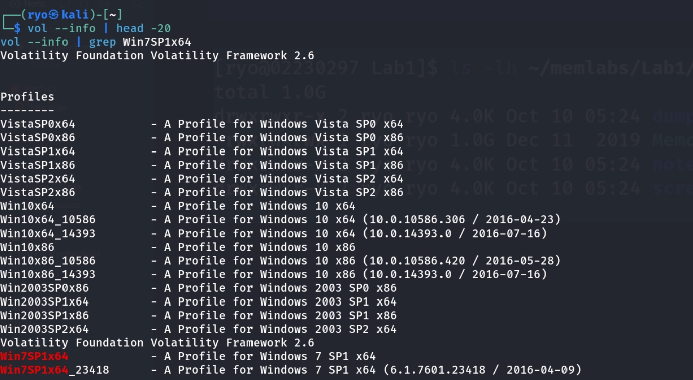

**Figure 0.1:** Volatility 2.6 working, with the Win7SP1x64 profile available

---
---

## Lab 1 – Beginner's Luck

| | |
|---|---|
| **Evidence file** | `MemoryDump_Lab1.raw` (1.0 GB) |
| **MD5** | `b9fec1a443907d870cb32b048bda9380` |
| **SHA256** | `88e708413898c98351d1a5a221799fc34460dfecb20e482ca5247b0b113b8cf2` |
| **Profile** | Win7SP1x64 |
| **Image date/time** | 2019-12-11 14:38:00 UTC (20:08 local, +0530) |

### 1.1 Story and Summary
A relative's computer crashed while she was in the middle of several tasks. In memory I found that, at the time of the crash, she had:
- a **command prompt** open, in which she had run a command that printed an encoded string,
- **WinRAR** open with a password-protected archive called `Important.rar`,
- **MS Paint** open with a drawing that was **never saved**.

I recovered all **three flags**.

### 1.2 Flags Found

| # | Flag | Where it was hiding | Figure |
|---|------|---------------------|--------|
| 1 | `flag{th1s_1s_th3_1st_st4g3!!}` | Base64 text printed in the command prompt | 1.9 |
| 2 | `flag{w3ll_3rd_stage_was_easy}` | Image `flag3.png` inside `Important.rar`; password = Alissa's NTLM hash | 1.15 |
| 3 | `flag{G00d_BoY_good_girL}` | Unsaved drawing in MS Paint's memory | 1.17 |

### 1.3 Investigation Log

#### Step 1 – Preparing and protecting the evidence
I made the lab folder and hashed the memory image before I started.

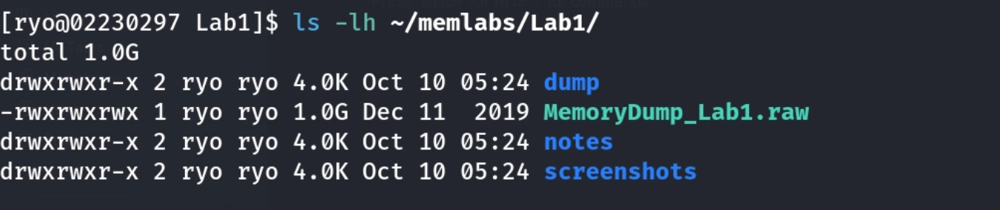

**Figure 1.1:** The Lab 1 working folder (dump, notes, screenshots)

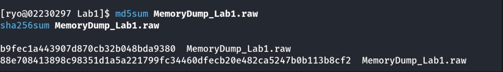

**Figure 1.2:** MD5/SHA256 hash of the evidence before analysis

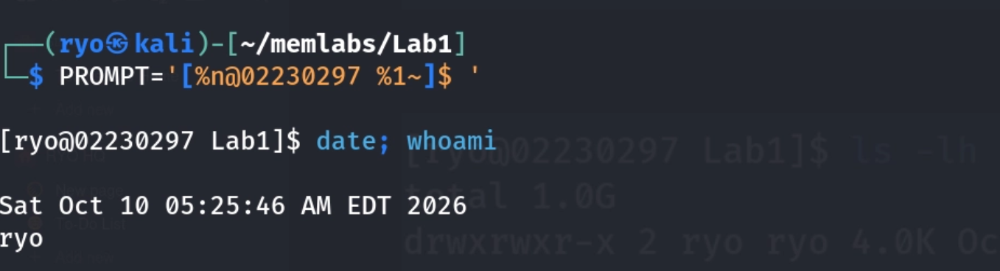

**Figure 1.3:** Recording the session with `script` and setting my student-ID prompt

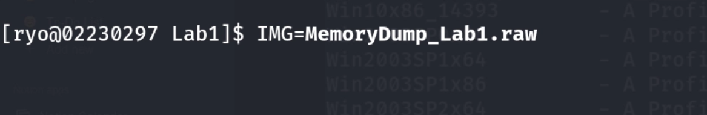

**Figure 1.4:** Saving the image name in a variable, so every command used the same evidence file

#### Step 2 – Scoping: what OS and what processes? (`imageinfo`, `pslist`, `pstree`)
`imageinfo` suggested **Win7SP1x64** as the first profile, so the computer was running **Windows 7 Service Pack 1, 64-bit**. It also told me when the memory was captured: **11 Dec 2019, 14:38 UTC**.

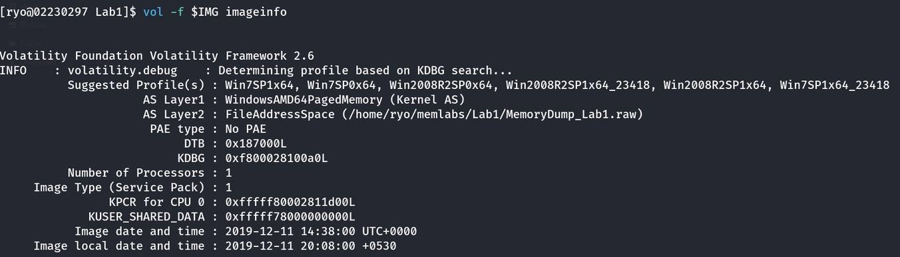

**Figure 1.5:** `imageinfo` suggesting Win7SP1x64 and showing the capture time

Next I listed the processes with `pslist` and showed the parent/child tree with `pstree`.

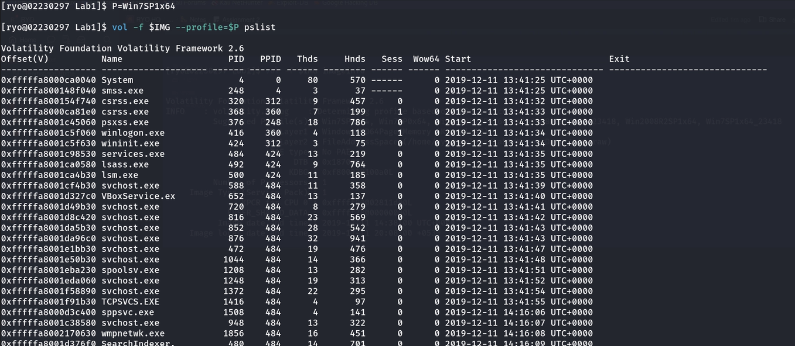

**Figure 1.6:** `pslist` – running processes

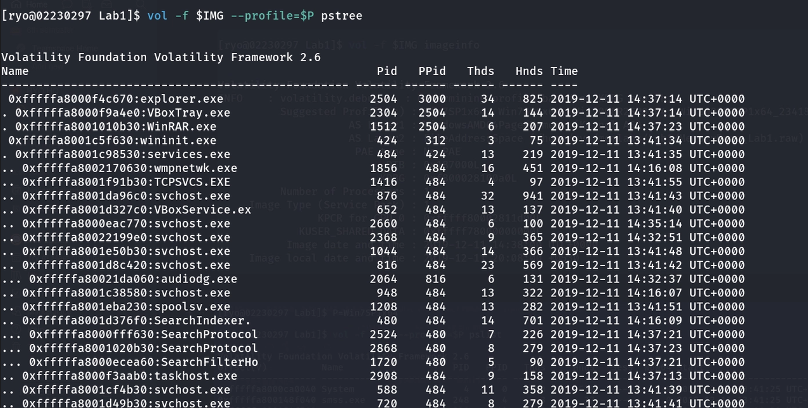

**Figure 1.7:** `pstree` – parent/child relationships

**Findings:**
- Most processes were normal Windows system processes (`smss.exe`, `csrss.exe`, `services.exe`, `lsass.exe`, `svchost.exe`, `explorer.exe`). `VBoxService.exe` shows the computer was a **VirtualBox** virtual machine.
- These processes belonged to the **user's own activity**:

| Process | PID | What it means |
|---|---|---|
| `cmd.exe` | 1984 | Command prompt – she typed something |
| `mspaint.exe` | 2424 | MS Paint – the "drawing" from the story |
| `WinRAR.exe` | 1512 | Archive manager – she had an archive open |

- **`DumpIt.exe` (PID 796)** is a **forensic tool**, not user activity. It is the program that captured this memory dump, so I ignored it as a lead.
- WinRAR's parent was `explorer.exe`, so she opened the archive herself (for example by double-clicking it).

#### Step 3 – Flag 1: command prompt history (`cmdscan`, then `consoles`)
I started with `cmdscan`, which shows the **commands that were typed**. It showed one command in `cmd.exe`: **`St4G3$1`**. It did not show what that command printed, so this was only half the story.

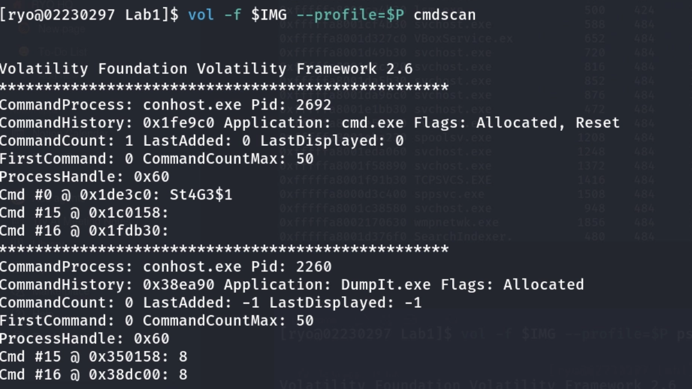

**Figure 1.8:** `cmdscan` – the user typed `St4G3$1`, but the output is not shown

Then I used `consoles`, which shows the **whole console screen**: both input and output. Under the `St4G3$1` command, the screen showed the string `ZmxhZ3t0aDFzXzFzX3RoM18xc3Rfc3Q0ZzMhIX0=`.

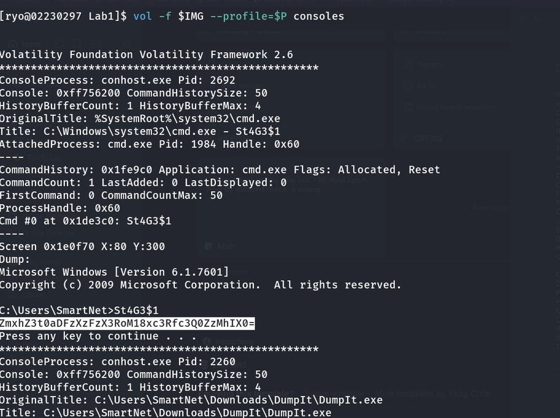

**Figure 1.9:** `consoles` – the encoded string printed in cmd.exe (highlighted)

The string uses only letters and numbers and ends with `=`, which is typical of **Base64**. I decoded it and got **Flag 1: `flag{th1s_1s_th3_1st_st4g3!!}`**.

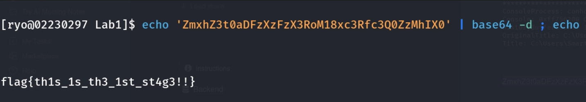

**Figure 1.10:** Base64 decoded – **Flag 1**

**Small findings from `consoles`:**
- The cmd window title was `cmd.exe - St4G3$1`. The console belonged to the user **SmartNet** (`C:\Users\SmartNet>`).
- A second console belonged to **DumpIt.exe**. It saved the dump as `SMARTNET-PC-20191211-143755.raw`, which confirms the computer name (**SMARTNET-PC**) and the capture time.

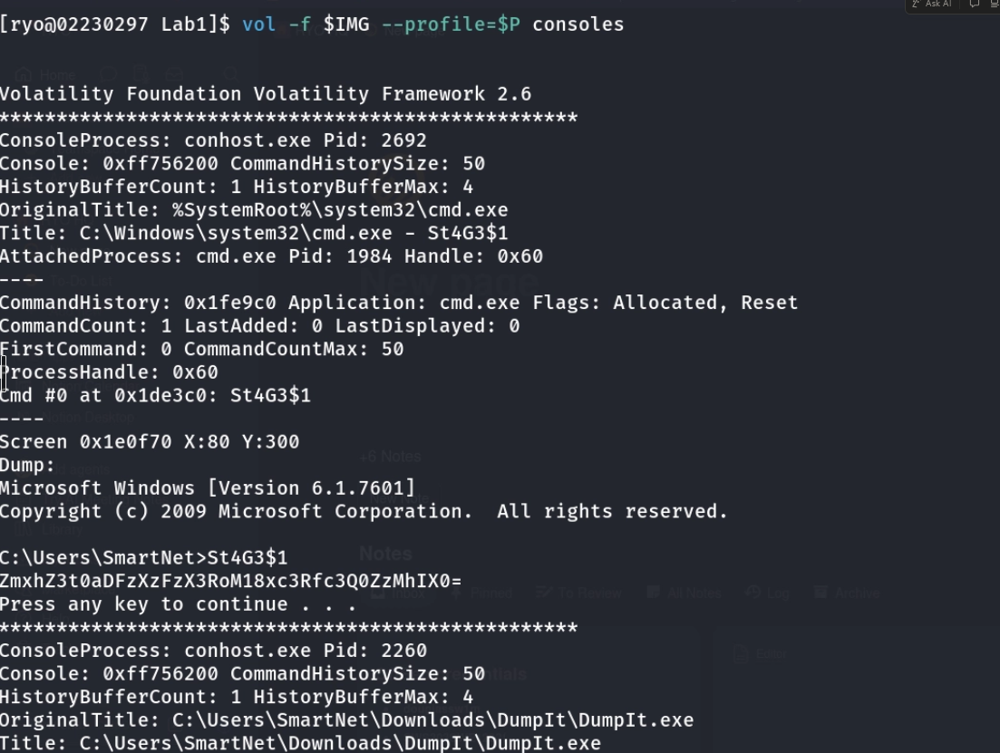

**Figure 1.11:** `consoles` – the DumpIt console (the memory capture tool)

#### Step 4 – Flag 2: the password-protected archive (`cmdline`, `filescan`, `dumpfiles`, `hashdump`)
**Which file did WinRAR have open?** I used `cmdline` on WinRAR (PID 1512). It had been started with `C:\Users\Alissa Simpson\Documents\Important.rar`. This told me a second user exists, **Alissa Simpson**, besides SmartNet.

*Dead end/mistake:* my first try failed with a zsh parse error, because I typed the placeholder `<archive_manager_PID>` instead of the real PID.

**Finding it in memory.** I used `filescan` to list every file object in memory. `Important.rar` appeared **three times**, in Alissa's Documents folder.

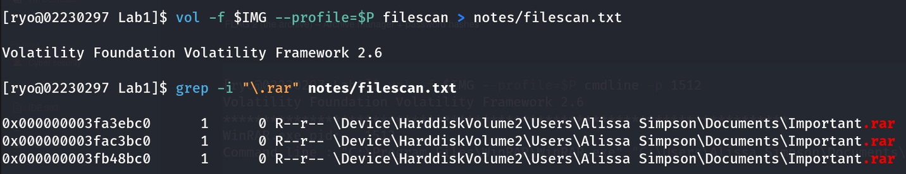

**Figure 1.12:** `filescan` – three memory offsets for Important.rar

**Extracting it.** I used `dumpfiles` with the first offset (`0x3fa3ebc0`). It saved a 45 KB file, and the `file` command identified it as **RAR archive data, v5**.

*Mistake:* my first try failed ("no such file or directory: offset"), because again I typed the placeholder `<offset>` instead of the real value.

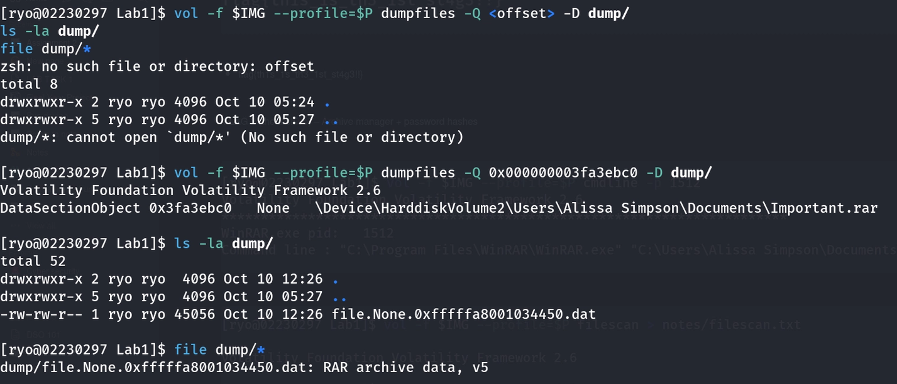

**Figure 1.13:** `dumpfiles` – the failed placeholder attempt, then the successful extraction (RAR v5)

**The archive was locked.** When I listed and tried to extract it, the archive comment said:
> *"Password is NTLM hash(in uppercase) of Alissa's account passwd."*

It contained one file, `flag3.png`.

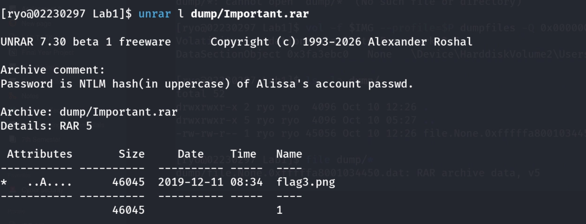

**Figure 1.14:** Archive comment with the password hint, and the file inside (flag3.png)

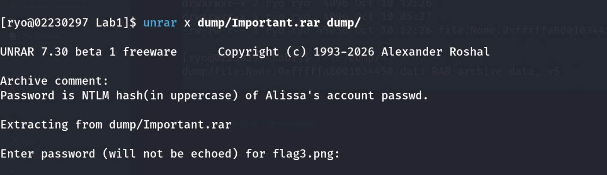

**Figure 1.15:** unrar asking for the password

**Getting the hash.** Windows keeps account password hashes in the SAM registry hive, and that hive is loaded in memory, so I used `hashdump`. Each line has the format `user : RID : LM hash : NTLM hash`.

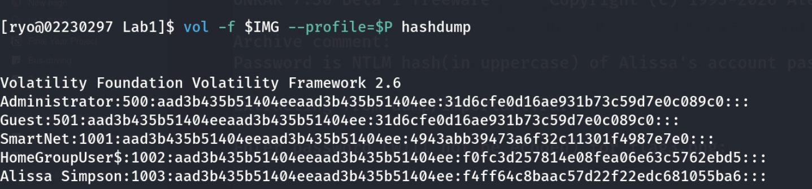

**Figure 1.16:** `hashdump` – Alissa Simpson's NTLM hash

**Findings:**
- Alissa Simpson (RID 1003) has the NTLM hash `f4ff64c8baac57d22f22edc681055ba6`.
- Administrator and Guest have the hash `31d6cfe0...`, which is the well-known hash of an **empty password**.
- The LM hash for every account is `aad3b435...`, which means LM hashes are disabled (normal for Windows 7).

I converted Alissa's NTLM hash to **uppercase**, as the hint said: `F4FF64C8BAAC57D22F22EDC681055BA6`. With that password, the archive extracted with **All OK**.

*Mistake:* my first attempt gave "Incorrect password" because I had pasted the placeholder text instead of the hash.

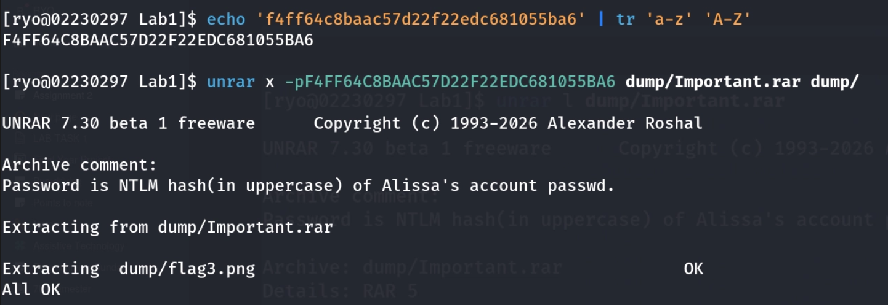

**Figure 1.17:** Uppercase hash used as the password – extraction **All OK**

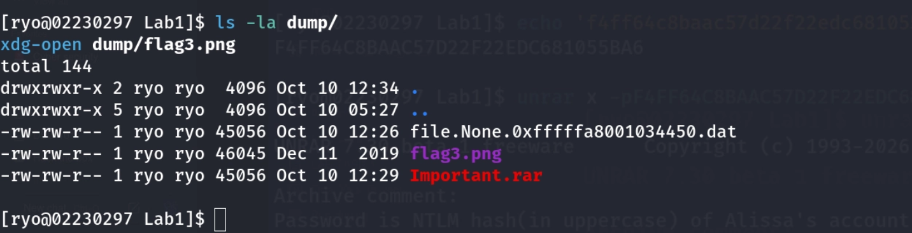

**Figure 1.18:** `flag3.png` recovered in the dump folder

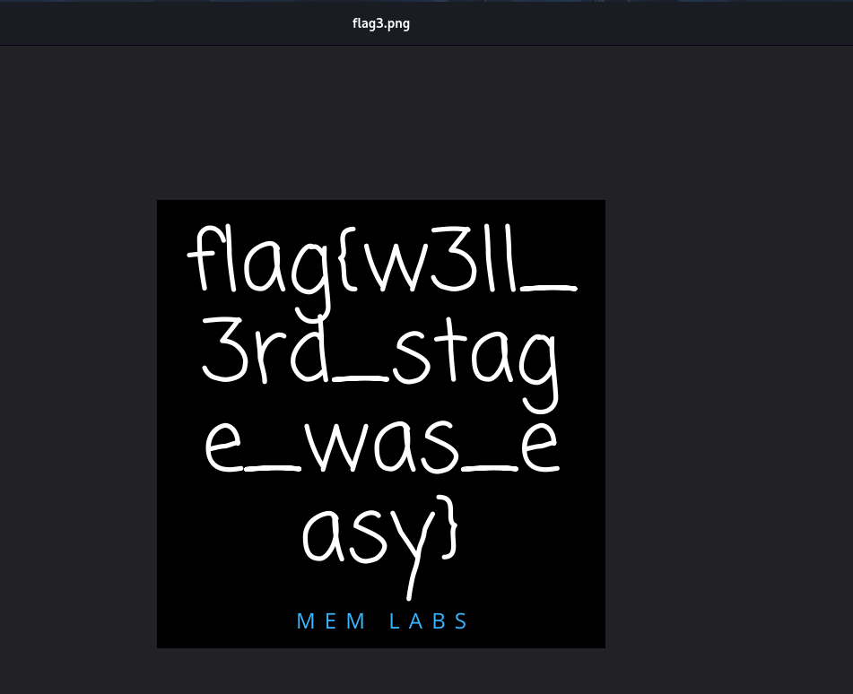

**Figure 1.19:** `flag3.png` – **Flag 2: `flag{w3ll_3rd_stage_was_easy}`** (MemLabs calls this the "3rd stage" flag)

#### Step 5 – Flag 3: the drawing in MS Paint (`memdump` + GIMP)
**Dead end 1 – looking for a saved picture.** I searched the `filescan` output for `.png`, `.bmp` and `.jpg` files. I only found Windows system images (a Media Player icon, desktop wallpapers and the default user picture). There was no saved drawing, so the picture had to exist **only in Paint's memory**.

**Dumping Paint's memory.** I used `memdump` on `mspaint.exe` (PID 2424). This saved everything that process had in RAM into one file, `2424.dmp`.

**Dead end 2 – searching for text.** I searched the dump for the text `flag{` and found nothing. This makes sense: a drawing is stored as **pixels**, not as text.

**Viewing the memory as a picture.** I renamed the dump to `.data` and opened it in GIMP as **raw image data**.
- My GIMP version had no "Image Type" option. In the newer GIMP it is called **Pixel format**, so I chose **RGB Alpha (RGBA 8-bit)**.
- I left the palette options at default, because they only matter for indexed-colour images.
- I changed the **offset** slowly until I found a white area with handwriting. Then I adjusted the **width** until the writing was straight instead of slanted.
- The image was upside down, so I flipped it vertically.
- *Problem:* GIMP also printed a warning, `Procedure 'file-raw-load': no mnemonic for property data-type`, when I opened it from the terminal. The import dialog still worked.

The drawing showed **Flag 3: `flag{G00d_BoY_good_girL}`**.

<!-- ADD YOUR SCREENSHOTS HERE: GIMP raw import settings, and the flipped drawing showing the flag -->
**Figure 1.20:** [ADD SCREENSHOT: GIMP raw-data import settings (pixel format, width, offset)]

**Figure 1.21:** [ADD SCREENSHOT: Recovered Paint drawing – **Flag 3**]

### 1.4 Forensic Reasoning (why each plugin was the right tool)

**Flag 1 – `consoles` vs `cmdscan`:** In Windows 7, a command prompt window is managed by `conhost.exe`, which keeps both the command history and the **screen buffer** in memory. `cmdscan` only reads the list of typed commands, so it showed `St4G3$1` but not the result. `consoles` reads the whole screen buffer, so it also showed what was printed. The flag was in the **output**, not the input, which is why `consoles` was the right plugin.

**Flag 2 – `filescan` + `dumpfiles` + `hashdump`:** When a program opens a file, Windows creates a file object and caches the file's data in RAM. `filescan` finds those objects and `dumpfiles` copies the cached data out, so I recovered `Important.rar` without the hard disk. For the password, Windows keeps the **SAM** hive (password hashes) and the **SYSTEM** hive (the key to decrypt them) loaded in memory. That is why `hashdump` could give me Alissa's NTLM hash directly from RAM.

**Flag 3 – `memdump`:** The drawing was never saved, so there was no file object for `filescan` to find. While Paint is open, the canvas sits in the process's memory as raw pixels. `memdump` saves that memory, and GIMP can display the bytes as pixels. The image comes out upside down because Windows bitmaps store pixel rows from bottom to top.

---
---

## Lab 2 – A New World

| | |
|---|---|
| **Evidence file** | `MemoryDump_Lab2.raw` |
| **MD5** | `ddb337936a75153822baed718851716b` |
| **SHA256** | `33d76b29683b38875d7a49bf91c23c58a72d0e1772e89f1b5ce19c25eccb9809` |
| **Profile** | Win7SP1x64 |
| **Image date/time** | 2019-12-14 10:38:46 UTC (16:08 local, +0530) |

### 2.1 Story and Summary
This Windows 7 computer had an open **browser (Google Chrome)** and an open **password manager (KeePass)**. I found three flags:
1. A Base64 string disguised as a folder path in a **fake environment variable** called `NEW_TMP`.
2. A password inside the **Recycle Bin of a KeePass database**. The master password was written on a picture in another user's folder.
3. A picture in a zip file behind a **mega.nz link** in Chrome's history. The zip was locked with the **SHA1 hash of my Lab 1 stage-3 flag**.

### 2.2 Flags Found

| # | Flag | Where it was hiding | Figure |
|---|------|---------------------|--------|
| 1 | `flag{w3lc0m3_T0_$T4g3_!_Of_L4B_2}` | `NEW_TMP` environment variable (Base64) | 2.10 |
| 2 | `flag{w0w_th1s_1s_Th3_SeC0nD_ST4g3_!!}` | KeePass database → Recycle Bin → entry "Sabka Baap" | 2.17 |
| 3 | `flag{oK_So_Now_St4g3_3_is_DoNE!!}` | `Important.png` from the mega.nz zip | 2.24 |

### 2.3 Investigation Log

#### Step 1 – Preparing and protecting the evidence

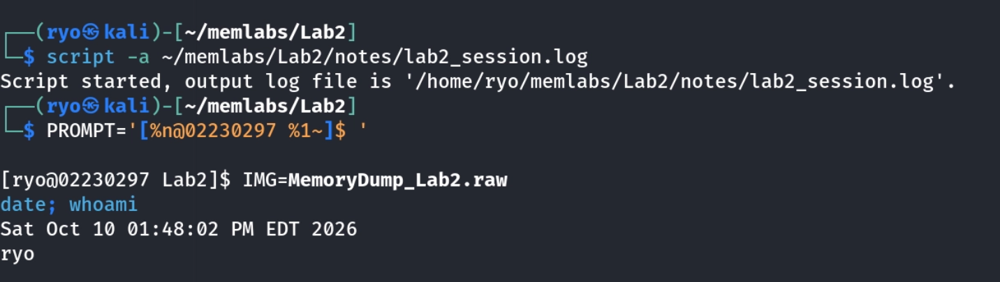

**Figure 2.1:** Session recording started, student-ID prompt, date and user

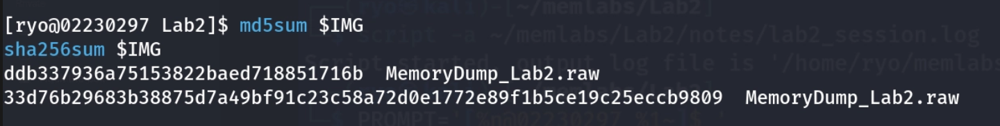

**Figure 2.2:** MD5 and SHA256 hash of the Lab 2 evidence

#### Step 2 – Scoping: what OS and what processes? (`imageinfo`, `pslist`, `pstree`)
`imageinfo` again suggested **Win7SP1x64** (Windows 7 SP1, 64-bit). The memory was captured on **14 Dec 2019 at 10:38 UTC**.

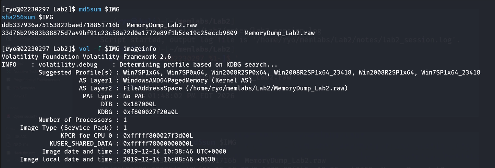

**Figure 2.3:** `imageinfo` – profile and capture time

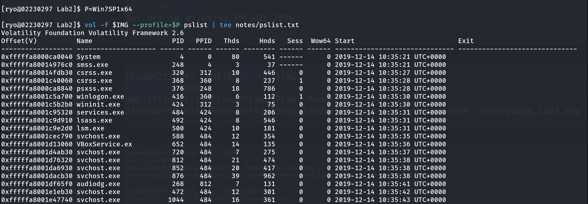

**Figure 2.4:** `pslist` – running processes

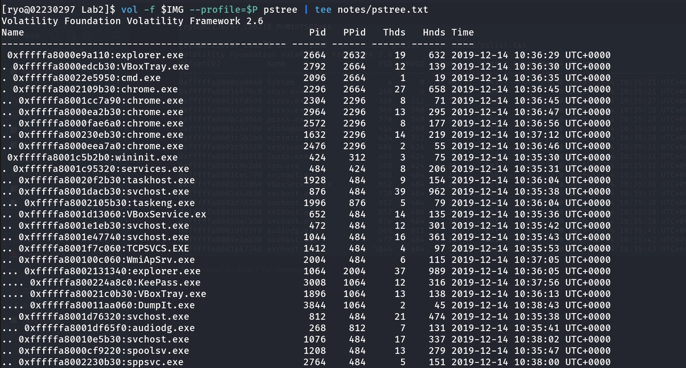

**Figure 2.5:** `pstree` – parent/child process tree

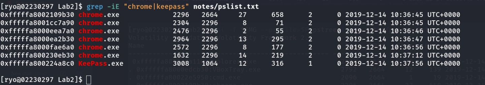

**Figure 2.6:** The two applications that stand out: Chrome and KeePass

**Findings:**
- **Six `chrome.exe` processes** (PIDs 2296, 2304, 2476, 2964, 2572, 1632). Chrome runs one main process (2296) and a separate child process for each tab or extension, which is why all the others have 2296 as their parent. This is the **browsing session**.
- **`KeePass.exe` (PID 3008)**, started at 10:37:56, about a minute before the capture. This is the **password manager**.
- I investigated each application separately, as the guidance suggested.

#### Step 3 – Flag 1: environment variables (`envars`)
`envars` printed **1,704 lines**, far too many to read one by one. So I counted how many times each variable **name** appeared. Rare or strange names stand out quickly this way.

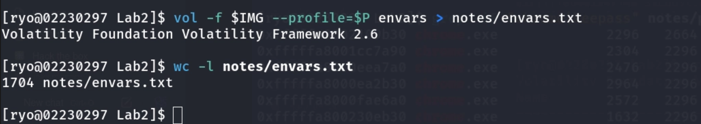

**Figure 2.7:** `envars` saved to a file – 1,704 lines

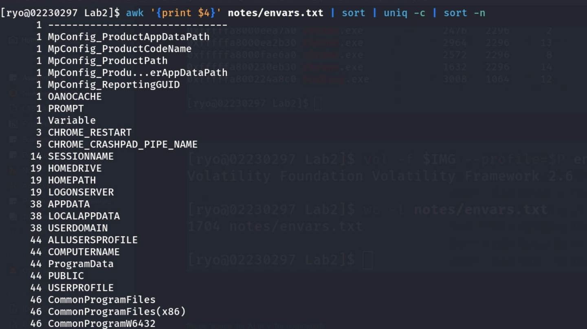

**Figure 2.8:** Counting variable names to find anything unusual

**Findings:**
- The rare names were all normal: `MpConfig_*` belongs to Windows Defender, `CHROME_RESTART` and `CHROME_CRASHPAD_PIPE_NAME` come from Chrome, and `OANOCACHE` and `PROMPT` are standard Windows variables.
- **`NEW_TMP` is not a real Windows variable.** It imitates `TEMP`/`TMP`. It appeared as often as `TEMP` and `TMP`, which means it was set **system-wide**: it was even inside `csrss.exe`, `winlogon.exe` and `wininit.exe`.

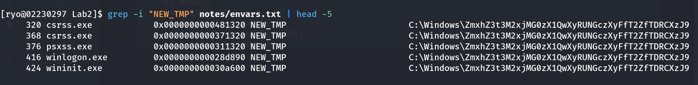

**Figure 2.9:** `NEW_TMP` – a value that looks like a folder path but ends in Base64

Its value looked like a folder path (`C:\Windows\ZmxhZ3t3...`), but the last part was Base64. `Zmxh` is Base64 for `fla`. I decoded it and got **Flag 1**.

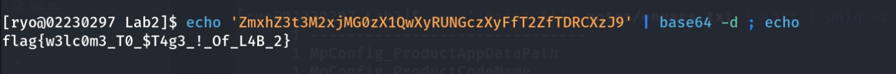

**Figure 2.10:** Base64 decoded – **Flag 1: `flag{w3lc0m3_T0_$T4g3_!_Of_L4B_2}`**

#### Step 4 – Flag 2: the KeePass database (`filescan`, `dumpfiles`, `hashdump`)
KeePass databases use the extension **`.kdbx`**. I searched the `filescan` output for it and found **`Hidden.kdbx`** in `C:\Users\SmartNet\Secrets\`.

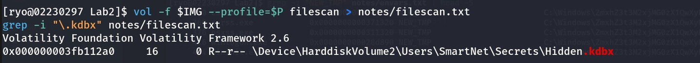

**Figure 2.11:** `filescan` – Hidden.kdbx in SmartNet's "Secrets" folder

The guidance said the master password would **not** be next to the database. I searched the whole file list for the word "password". Most results were KeePass's own program files. One stood out: **`Password.png`** in **Alissa Simpson's** Pictures folder, a different user from the database owner.

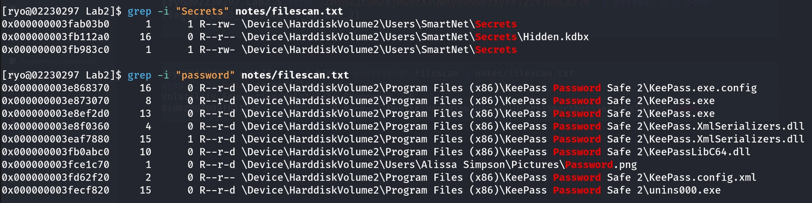

**Figure 2.12:** Searching for "Secrets" and "password" – Password.png in another user's folder

I extracted both files with `dumpfiles` and checked them with `file`: one was a **KeePass 2.x database** and the other a **PNG image (1587 × 2245)**. I renamed them to their real names.

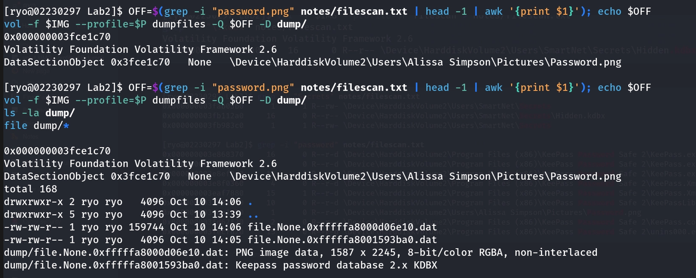

**Figure 2.13:** Both files extracted from memory and identified

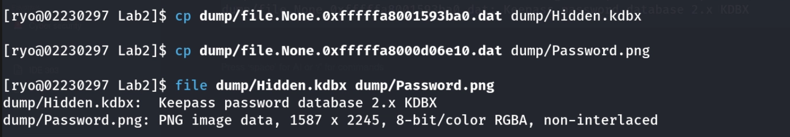

**Figure 2.14:** Files renamed to Hidden.kdbx and Password.png

The big text on the picture says *"WOW! YOU ARE HERE!! BUT THE FLAG IS NOT HERE!! :P"*. In the bottom-right corner, in very small text, it says **"Psst!! password is P4SSw0rd_123"**: the KeePass master password.

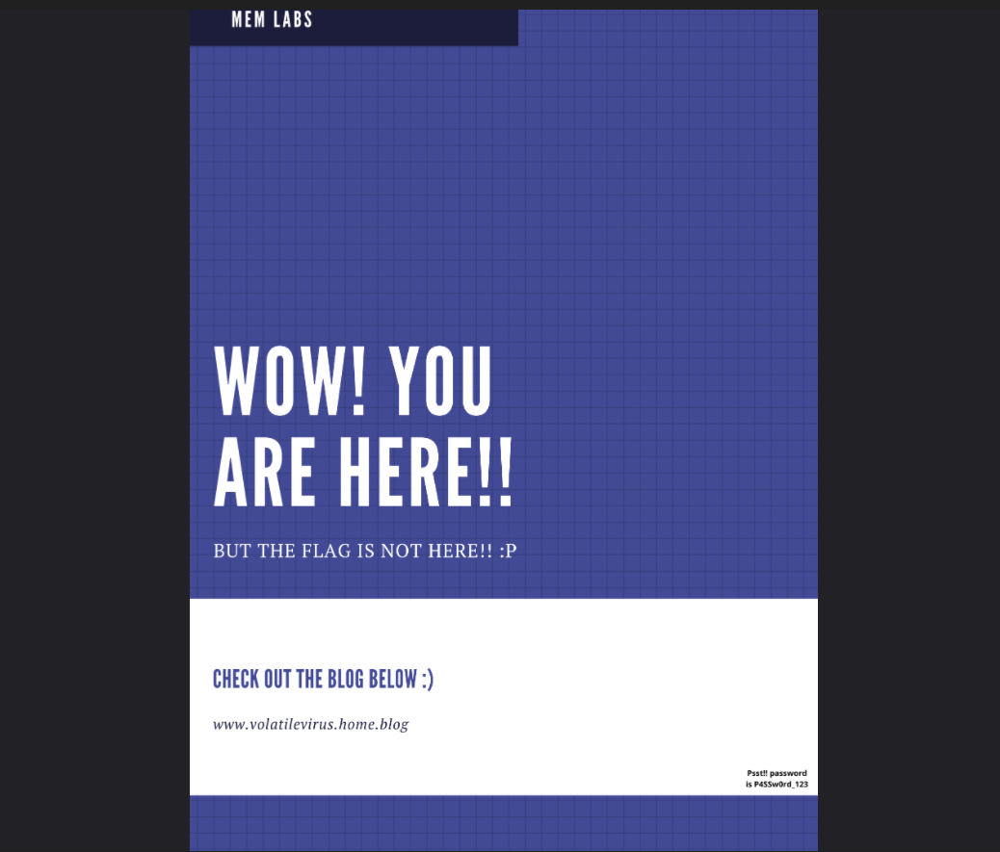

**Figure 2.15:** Password.png – master password `P4SSw0rd_123` in the bottom-right corner

**Cross-check with `hashdump` (dead end):** The Part B checklist says to check credentials. The Windows hashes were **exactly the same as in Lab 1**, which shows Lab 1 and Lab 2 are from the **same computer**. But KeePass uses its own master password, not the Windows password, so these hashes did not help open the database.

I then unlocked the database with KeePassXC's command-line tool and the master password. It had the normal groups (General, Windows, Network, Internet, eMail, Homebanking) and a **Recycle Bin**. The Recycle Bin had three entries: `Sample Entry` and `Sample Entry #2` (KeePass's default examples) and **`Sabka Baap`**, which the user created.

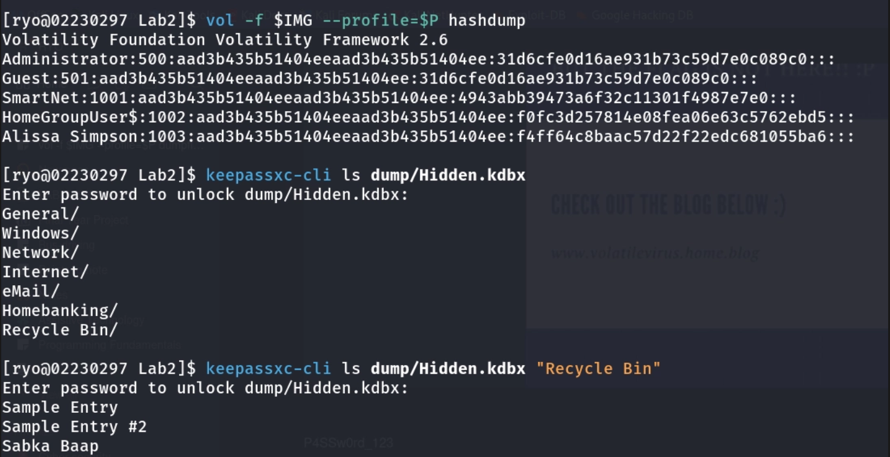

**Figure 2.16:** `hashdump` cross-check (dead end), then the KeePass groups and Recycle Bin entries

*Mistake:* my first two attempts to open the entry failed ("Could not find entry"), because I typed a placeholder instead of the real entry name.

When I showed the `Sabka Baap` entry, its **username was "Flag"** and its **password was Flag 2**.

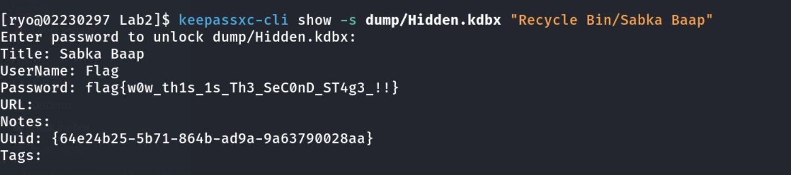

**Figure 2.17:** Deleted KeePass entry "Sabka Baap" – **Flag 2: `flag{w0w_th1s_1s_Th3_SeC0nD_ST4g3_!!}`**

#### Step 5 – Flag 3: Chrome history and the Lab 1 flag
**Dead end – the `chromehistory` plugin did not load.** I downloaded the community plugin pack, but Volatility said *"You must specify something to do"*. When I checked why, the plugin failed with **`ImportError: No module named csv`**. The standalone Volatility binary has its own built-in Python, and that Python does not include the `csv` module. I also tried a patched copy of the plugin, which didn't work either.

**Workaround – read Chrome's history file myself.** Chrome stores its history in an **SQLite database file called `History`**. That file was open, so it was in `filescan`.
- I extracted it with `dumpfiles`. This produced two files: a real 118 KB data file, and an **empty `.vacb` file** (a cache-map copy with no data in it).
- The first time I made a mistake: I copied the wrong file, so `sqlite3` said "no such table: urls". With the correct file it worked.
- I read the `urls` table and found a **mega.nz** link: `https://mega.nz/#F!TrgSQQTS!H0ZrUzF0B-ZKNM3y9E76lg`

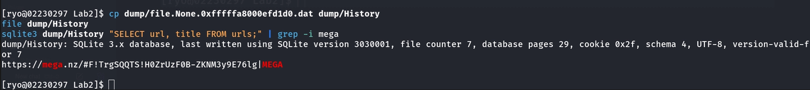

**Figure 2.18:** Chrome's History database read with sqlite3 – the mega.nz link

I opened the link. It was a MEGA folder called **"MemLabs_Lab2_Stage3"** containing `Important.zip`, and I downloaded it.

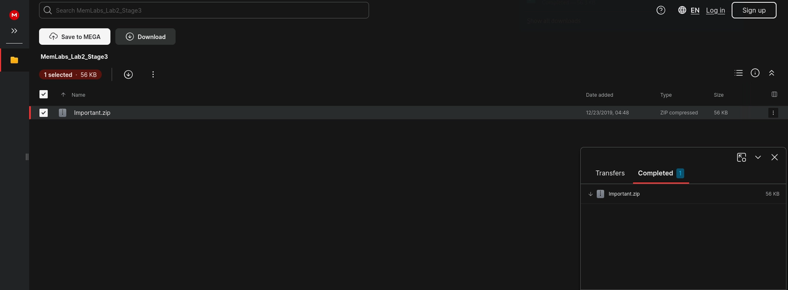

**Figure 2.19:** The MEGA folder with Important.zip

*Problem:* my first try to list the zip failed because the download had not actually finished. When I downloaded it again, I found the zip contained **another `Important.zip` inside it**. I extracted the inner zip into a separate `mega` folder, and I chose **not** to overwrite my original download.

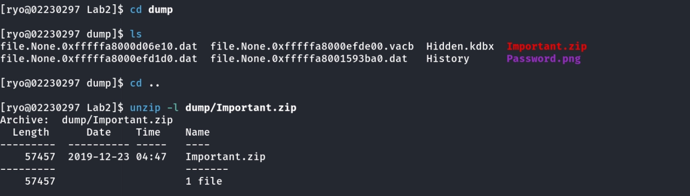

**Figure 2.20:** The downloaded zip contained another Important.zip

The inner zip's comment said:
> *"Password is SHA1(stage-3-FLAG) from Lab-1. Password is in lowercase."*

**Dead end – wrong hash.** At first I hashed the wrong text: I used the Lab 2 Flag 1 instead of the Lab 1 stage-3 flag. That gave `25761e0a…`, and 7-Zip said **Wrong password**. 7-Zip still created a **0-byte `Important.png`**, so a file appearing does **not** mean extraction worked.

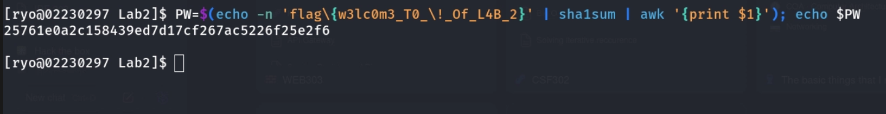

**Figure 2.21:** Dead end – SHA1 of the wrong flag (`25761e0a…`)

With the correct Lab 1 stage-3 flag, `flag{w3ll_3rd_stage_was_easy}`, the SHA1 was **`6045dd90029719a039fd2d2ebcca718439dd100a`**. 7-Zip accepted it and asked to replace the 0-byte file with the real **59,291-byte** image.

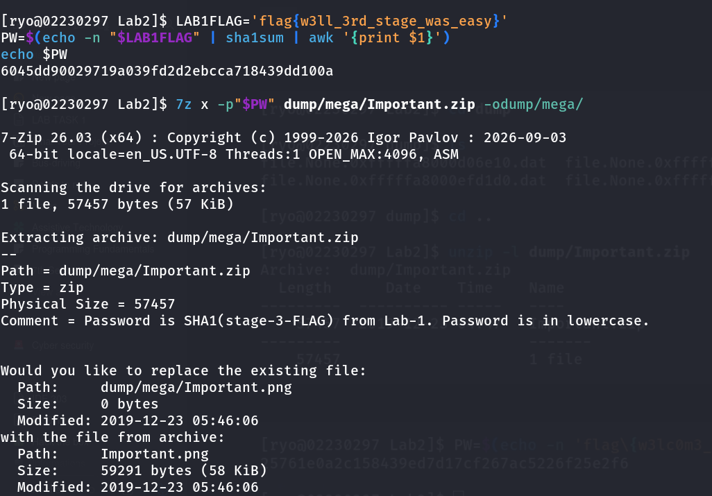

**Figure 2.22:** Correct SHA1 of the Lab 1 flag, and the zip comment

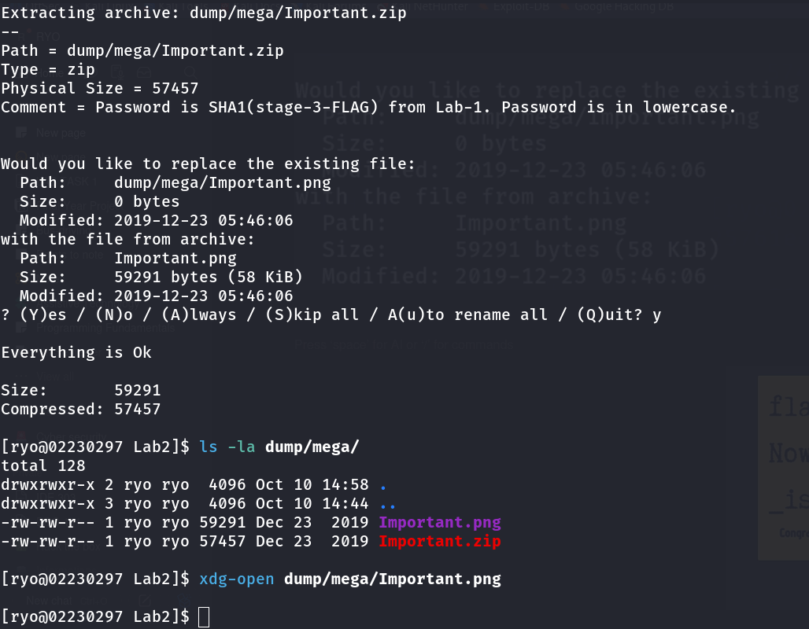

**Figure 2.23:** Extraction succeeded ("Everything is Ok") – Important.png is 59,291 bytes

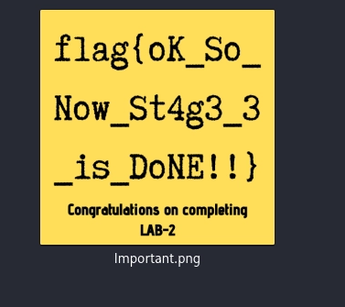

**Figure 2.24:** Important.png – **Flag 3: `flag{oK_So_Now_St4g3_3_is_DoNE!!}`**

### 2.4 How I Derived the Final Archive Password
The zip comment said the password is **SHA1 of the stage-3 flag from Lab 1, in lowercase**. Lab 1's stage-3 flag is the one inside `flag3.png`: `flag{w3ll_3rd_stage_was_easy}`.
- I hashed the **whole flag exactly as written**, including `flag{` and `}`, with the **SHA1** function.
- I made sure **no newline character** was added at the end. A hidden newline changes the input, so the hash would be completely different.
- `sha1sum` already prints its result in **lowercase hex**, which is what the comment asked for.

So the password was `6045dd90029719a039fd2d2ebcca718439dd100a`. My first attempt used the wrong flag and failed, which shows that the exact input matters.

### 2.5 Forensic Reasoning
- **`envars`:** Every Windows process keeps its own copy of the environment variables in its **Process Environment Block (PEB)** in memory. `envars` reads them all, so it found `NEW_TMP` even though nothing ever displayed it. Because system processes like `csrss.exe` had it, I knew it was set system-wide.
- **KeePass:** KeePass had `Hidden.kdbx` open, so Windows had the file cached in RAM, and `filescan` + `dumpfiles` could recover it. "Deleting" an entry in KeePass only moves it to the **Recycle Bin group inside the same file**, so the flag was still in the database.
- **Chrome history:** Volatility 2 has no built-in Chrome plugin. When the community plugin failed, I did manually what the plugin does: I found Chrome's SQLite `History` file in memory, extracted it, and read the `urls` table.

---
---

## Lab 3 – The Evil's Den

| | |
|---|---|
| **Evidence file** | `MemoryDump_Lab3.raw` (1000 MB) |
| **MD5** | `ce4e7adc4efbf719888d2c87256d1da3` |
| **SHA256** | `a43797b924f7de2629dc466f61e3c7edff1484e9ad6ac702bddd4c9d5f4be1e5` |
| **Profile** | Win7SP1x86_23418 (**32-bit**) |
| **Image date/time** | 2018-09-30 09:47:54 UTC (15:17 local, +0530) |

### 3.1 Story and Summary
A malicious Python script had encoded a secret. The flag was split into two halves:
- I recovered the script and its output from memory and read the code. It **XORs every character with 3 and then Base64-encodes** the result. I reversed that to get the **first half**.
- The **second half** was hidden inside a JPEG with **steghide**. The passphrase was the first half.

### 3.2 Flag Found

| Part | Value | Figure |
|---|---|---|
| First half | `inctf{0n3_h4lf` | 3.11 |
| Second half | `_1s_n0t_3n0ugh}` | 3.17 |
| **Full flag** | **`inctf{0n3_h4lf_1s_n0t_3n0ugh}`** | 3.18 |

### 3.3 Investigation Log

#### Step 1 – Getting and protecting the evidence

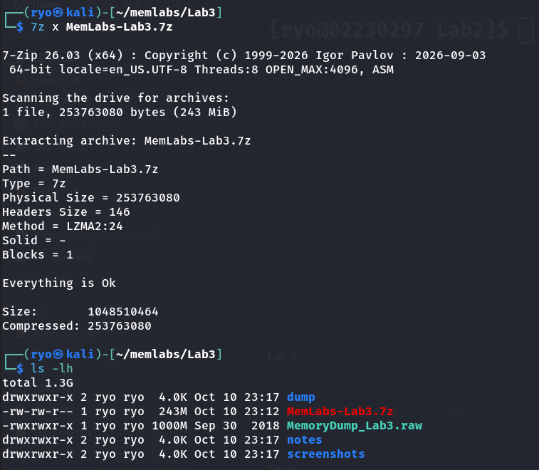

**Figure 3.1:** Extracting the Lab 3 archive (243 MB → 1000 MB raw image)

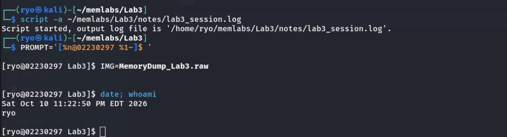

**Figure 3.2:** Session recording started with my student-ID prompt

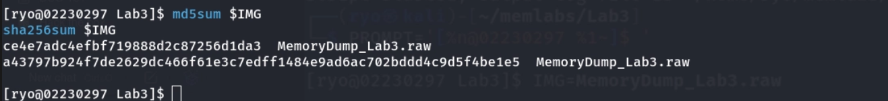

**Figure 3.3:** MD5/SHA256 hash of the evidence

#### Step 2 – Scoping: what OS and what processes? (`imageinfo`, `pslist`)
**Different from Labs 1 and 2:** `imageinfo` suggested **Win7SP1x86_23418**, a **32-bit** Windows 7. I had to change my profile, because Volatility needs the correct profile to know where Windows keeps its internal structures in memory. The capture time was **30 Sep 2018, 09:47 UTC**.

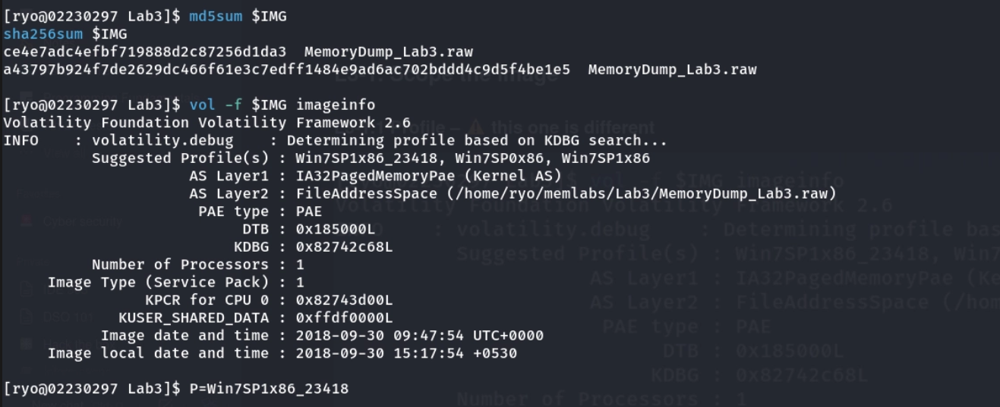

**Figure 3.4:** `imageinfo` – a 32-bit (x86) profile this time

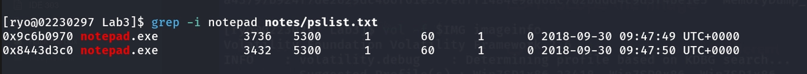

**Figure 3.5:** Process list – two `notepad.exe` processes

**Findings:**
- There were **two `notepad.exe` processes** (PIDs **3736** and **3432**), started one second apart at 09:47:49 and 09:47:50, only a few seconds before the capture. Both had the same parent (5300). Notepad is the "text-editing process" from the guidance.
- `DumpIt.exe` was in the user **hello**'s Desktop folder. It is again the memory capture tool, not user activity.

#### Step 3 – Which files was Notepad editing? (`cmdline`, `cmdscan`, `consoles`)
`cmdline` showed the file each Notepad was started with:
- Notepad 1 → `C:\Users\hello\Desktop\evilscript.py` (the **script**)
- Notepad 2 → `C:\Users\hello\Desktop\vip.txt` (its **output**)

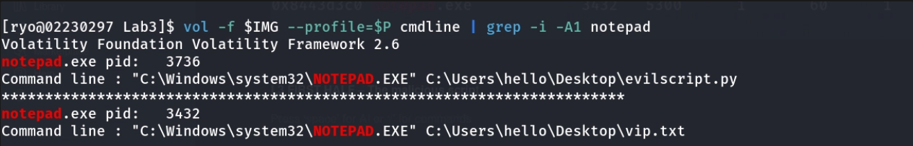

**Figure 3.6:** `cmdline` – Notepad opened evilscript.py and vip.txt

I also ran `cmdscan` and `consoles` from the checklist. They only showed the DumpIt console and some unreadable garbage entries, with no useful commands, so this was a dead end.

#### Step 4 – Finding and extracting the two files (`filescan`, `dumpfiles`)
`filescan` listed **7,117** file objects. Filtering for the two names found:
- `\Users\hello\Desktop\evilscript.py.py`, opened read-only (`R--`)
- `\Users\hello\Desktop\vip.txt`, opened for **writing** (`-W-`)

**Figure 3.7:** `filescan` – evilscript.py.py and vip.txt on hello's Desktop

**Findings:**
- The real file name is **`evilscript.py.py`**, a **double extension**. This often happens when Windows hides known file extensions and the user types `.py` again.
- The access flags match the story: the script was **read**, and `vip.txt` was **written to**, because the script saved its result there.

I extracted both files with `dumpfiles` into separate folders, so they would not mix.

**Figure 3.8:** Extracting the script and the output file from memory

**Figure 3.9:** Both files extracted and renamed

#### Step 5 – Reading the script (I did not run it)
I **read the code instead of running it**. It is malware from the evidence, and running unknown code could harm my machine or change my evidence.

**Figure 3.10:** The source code of evilscript.py.py

**What the script does:**
1. It takes the secret from the **command line** (`sys.argv[1]`).
2. `xor()` changes every character by **XOR-ing it with the number 3**.
3. `encoder()` turns the result into **Base64** (Python 2 style).
4. It writes the result to `C:\Users\hello\Desktop\vip.txt`.

The code is `encoder(xor(arr))`, and the inner function runs first, so the order is **XOR → Base64**.

#### Step 6 – First half: reversing the encoding
`vip.txt` contained `am1gd2V4M20wXGs3b2U=`.

*Problem:* when I first decoded it, the output was followed by **"base64: invalid input"**. `dumpfiles` saves whole memory pages (4,096 bytes), so the rest of this small file was filled with **null bytes**. I kept only the real first line and removed the padding.

**Figure 3.11:** The encoded content of vip.txt, and the "invalid input" problem

To reverse the script, I undid the steps **in the opposite order**: **Base64-decode first, then XOR with 3**. The result was the **first half: `inctf{0n3_h4lf`**.

**Figure 3.12:** Base64 decode + XOR 3 – **first half `inctf{0n3_h4lf`**

**Figure 3.13:** Decoding the cleaned file

I also wrote **my own reversing script, `reverse.py`**. It:
1. reads the output file,
2. removes the null padding,
3. Base64-decodes it,
4. XORs every byte with 3.

It printed the same first half.

**Figure 3.14:** My own `reverse.py` script and its output

#### Step 7 – Second half: steganography (`filescan`, `dumpfiles`, steghide)
The task mentioned steganography, so I searched `filescan` for photo files (`.jpg`/`.jpeg`).

**Figure 3.15:** Image files in memory – one is out of place

**Findings:**
- Almost every JPEG was in `Temporary Internet Files\Content.IE5\`, with random names like `BBNIP4D[1].jpg`. These are normal Internet Explorer cache images.
- **One file was different: `suspision1.jpeg` on hello's Desktop.**
  - It was in the user's own folder, not a cache folder.
  - It used `.jpeg`, not `.jpg`.
  - Its name is a misspelling of "suspicion".
  - It was opened read/write (`RW`).

I extracted it with `dumpfiles` and confirmed it was a real JPEG.

**Figure 3.16:** suspision1.jpeg extracted from memory

The lab's description gives the key in **Note-2**: you need the first half of the flag to get the second half. So the natural passphrase for steghide was the first half, **`inctf{0n3_h4lf`**.

**Figure 3.17:** Lab 3 description – Note-2 hint

steghide accepted the passphrase and wrote the hidden data to `secret.txt`, which contained the **second half: `_1s_n0t_3n0ugh}`**.

**Figure 3.18:** steghide extraction with the first half as the passphrase – **second half**

Joining both halves gives the full flag.

**Figure 3.19:** **Full flag: `inctf{0n3_h4lf_1s_n0t_3n0ugh}`**

### 3.4 What the Script Did and How I Reversed It
The script took a secret from the command line and did two things to it, in this order:
1. **XOR with 3:** each character's number was XOR-ed with 3, for example `i` (105) → `j` (106).
2. **Base64-encode:** the result was turned into Base64 text and saved in `vip.txt`.

To undo it, I did the opposite steps **in reverse order**:
1. **Base64-decode** the text from `vip.txt`.
2. **XOR every byte with 3 again.** XOR undoes itself when you use the same key: `(a XOR 3) XOR 3 = a`.

My `reverse.py` (Figure 3.14) does exactly this. It also removes the null-byte padding that `dumpfiles` added.

### 3.5 Forensic Reasoning
- **`cmdline`** shows how each process was started. For Notepad, that includes the file it opened, so it pointed me straight to the script and its output.
- **`filescan` + `dumpfiles`** recovered both files because Windows still had them cached in memory. The access flags (`R` vs `W`) even showed which file was read and which was written.
- **Steganography** hides data inside an image's data without visibly changing the picture, so the JPEG looked normal. steghide needs the correct passphrase, and Note-2 told me the first half was that key.

---
---

## Lab 4 – Obsession

| | |
|---|---|
| **Evidence file** | `MemoryDump_Lab4.raw` |
| **MD5** | `b0dd82624c51d4b2d689ba38812aa9e1` |
| **SHA256** | `53289a00f74397798928603356c81ae9d3cd3aff009472307e9d364fad252c49` |
| **Profile** | Win7SP1x64 |
| **Image date/time** | 2019-06-29 07:30:00 UTC (13:00 local, +0530) |

### 4.1 Story and Summary
The important file in this lab had been **deleted**.
- First I had to work around a **broken process list**.
- Then I checked a suspicious image, `galf.jpeg` ("flag" backwards). It turned out to be a **deliberate distraction**.
- The real evidence was `Important.txt`. It had **no file object** left in memory, so `dumpfiles` could not recover it.
- Its content was still stored inside its **NTFS Master File Table (MFT) record**, and `mftparser` recovered the flag from there.

### 4.2 Flag Found

| Flag | Where it was hiding | Figure |
|---|---|---|
| `inctf{1_is_n0t_EQu4l_7o_2_bUt_th1s_d0s3nt_m4ke_s3ns3}` | Resident `$DATA` in the MFT record of the deleted `Important.txt` | 4.15, 4.16 |

### 4.3 Investigation Log

#### Step 1 – Preparing and protecting the evidence

**Figure 4.1:** Starting Lab 4

**Figure 4.2:** Lab 4 description

**Figure 4.3:** MD5/SHA256 hash of the evidence

#### Step 2 – Scoping: what OS and what processes? (`imageinfo`, `pslist`, `kdbgscan`, `psscan`)
`imageinfo` suggested **Win7SP1x64** (Windows 7 SP1, 64-bit). The capture time was **29 June 2019, 07:30 UTC**.

**Figure 4.4:** `imageinfo`

**Problem – the process list was broken.** Both `pslist` and `pstree` failed with *"Could not list tasks, please verify your --profile with kdbgscan"*.

**Figure 4.5:** `pslist` failing – "Could not list tasks"

`pslist` works by finding a kernel structure called the **KDBG** and following the list of processes it points to. I ran `kdbgscan` to check the KDBG. It found **only one KDBG** (at physical offset `0x27f60a0`), so there was no better copy to switch to. The process list it points to was not usable.

**Figure 4.6:** `kdbgscan` – only one KDBG found

**Workaround – `psscan`.** Instead of following the linked list, `psscan` scans all of memory for process structures using their **pool tag** (a small label Windows puts on each memory allocation). That worked.

**Figure 4.7:** `psscan` – the process list recovered by scanning

**Findings:**
- **`explorer.exe` (PID 1944)** is the user's desktop.
  - It started **`VBoxTray.exe`**, which shows this was a **VirtualBox VM**.
  - It also started **`DumpIt.exe`**, the memory capture tool.
- **`GoogleCrashHandler`** processes show Chrome was installed.
- `csrss.exe` (2672) and `LogonUI.exe` (2148) had **exit times** (07:29:59). `psscan` can show processes that have already ended, which `pslist` cannot.
- **No user programs** (Notepad, WinRAR, Paint) were open. So the evidence had to be in the **files**, not in a running program.

#### Step 3 – Files on the Desktop (`filescan`)
I searched the `filescan` output for "desktop".

**Figure 4.8:** Desktop files and Important.lnk in `filescan`

**Findings:**
- There are two users: **`eminem`** and **`SlimShady`**.
- **`galf.jpeg`** on eminem's Desktop is "flag" spelled backwards, which is probably a trick.
- `Screenshot1.png` is also on the Desktop.
- **`2PAC-20190629-072925.raw`** is DumpIt's output file, so the computer's name is **2PAC**.
- **`Important.txt` was not in `filescan` at all.** The only trace was **`Important.lnk`** in SlimShady's `Recent` folder. Windows creates these shortcuts automatically when a user **opens** a file. This proves `Important.txt` existed and was opened, even though its file object was gone.

#### Step 4 – Dead end: the steganography image (`galf.jpeg`)
I extracted `galf.jpeg` with `dumpfiles` (229 KB).

*Mistake:* my first attempt to open it failed with "No such file or directory", because I had skipped the step that renames the dumped file. After renaming it, it opened fine.

**Figure 4.9:** Extracting galf.jpeg from memory

**Figure 4.10:** galf.jpeg identified as a JPEG

**Figure 4.11:** The galf.jpeg picture

Then I ran the basic steganography checks:
- **exiftool:** normal metadata.
- **strings:** no "inctf", "flag" or "pass" text.
- **binwalk:** only normal JPEG data, nothing hidden at the end.
- **steghide with an empty passphrase:** it extracted a small hidden message that says ***"Move on bro, there is nothing here :)"***

**Figure 4.12:** Stego checks – the hidden message tells me to move on (dead end)

**Why I moved on, and why a dead end still counts:** the image's own hidden message confirmed it was a **decoy**, so I stopped spending time on it. Writing it down still matters. It shows the image was **checked and ruled out on purpose, not ignored**. Anyone reviewing my work can see it was tested and does not need to repeat it. A complete investigation records what was **not** found as well as what was.

#### Step 5 – Trying to dump Important.txt the normal way (it failed)
There was no `filescan` offset for `Important.txt`, so I asked `dumpfiles` to search for it **by name**. **Nothing was extracted.**

**Figure 4.13:** `dumpfiles` on Important.txt – nothing recovered

**What this means forensically:** the file's object and its cached data were no longer in RAM, because the file had been **deleted/closed**. `dumpfiles` can only copy what is cached in memory, so it had nothing to copy.

#### Step 6 – Recovering the file from the MFT (`mftparser`) – the flag
I ran `mftparser` (it took about 19 seconds) and saved the output. Then I searched it for "Important.txt".

**Figure 4.14:** Running `mftparser` and finding the Important.txt record

The record was for **`Users\SlimShady\Desktop\Important.txt`**, created on **27 June 2019 at 13:14 UTC**, two days before the capture. The file was small, so its **content was stored inside the MFT record itself** (resident `$DATA`). The hex dump showed the flag, broken up by many line breaks (`0d 0a`). The author pressed Enter many times between the parts of the flag to make it harder to read.

**Figure 4.15:** MFT record of Important.txt – the flag in the resident `$DATA`

I joined the hex back into text and removed the line breaks to read the flag cleanly. The text after it, `Good work :P`, is a message from the author and not part of the flag.

**Figure 4.16:** **Flag: `inctf{1_is_n0t_EQu4l_7o_2_bUt_th1s_d0s3nt_m4ke_s3ns3}`**

### 4.4 Why `dumpfiles` Failed but `mftparser` Worked
`dumpfiles` does not read the hard disk. It copies a file's **cached data from RAM**, which it finds through the file's **file object** (the same objects `filescan` lists). After `Important.txt` was deleted, its file object and cached pages were gone from memory. That is why it was missing from `filescan`, and why `dumpfiles` had nothing to copy. Only the `Important.lnk` shortcut showed that the file had ever existed.

NTFS works differently. It keeps a **1 KB record for every file in the Master File Table (MFT)**, and for **small files (under about 700 bytes) the actual content is stored inside that record** ("resident" data). When a file is deleted, NTFS only marks its MFT record as "free". The bytes stay there until something overwrites them, and this record was still cached in RAM. `mftparser` searches memory for MFT records by their `FILE` signature, so it found the record and the content inside it.

**Lesson:** a file not appearing in a file listing does not mean its content is gone. Different artifacts survive deletion in different ways.

---
---

## Lab 5 – Black Tuesday

| | |
|---|---|
| **Evidence file** | `MemoryDump_Lab5.raw` (1.0 GB) |
| **MD5** | `9dd6cb1134c9b018020bad44f27394db` |
| **SHA256** | `08725b77ed2a447b128e12c031c17db4524f36920db791e27452b5d9165ff83a` |
| **Profile** | Win7SP1x64 |
| **Image date/time** | 2019-12-20 03:47:57 UTC (09:17 local, +0530) |

### 5.1 Story and Summary
WinRAR had a password-protected archive open. The archive's name, `SW1wb3J0YW50`, is Base64 for **"Important"**.
- Instead of brute-forcing the password, I looked at the **Internet Explorer/Windows Explorer history** with the built-in `iehistory` plugin.
- It showed the user had opened a `.bmp` file with a very long, **Base64-encoded name**.
- Decoding that name gave **Flag 1**, which was also the **archive password**.
- The archive contained **Flag 2**.

### 5.2 Flags Found

| # | Flag | Where it was hiding | Figure |
|---|------|---------------------|--------|
| 1 | `flag{!!_w3LL_d0n3_St4g3-1_0f_L4B_5_D0n3_!!}` | Encoded file name in the IE/Explorer history | 5.15 |
| 2 | `flag{W1th_th1s_$taGe_2_1s_c0mPL3T3_!!}` | `Stage2.png` inside the RAR, unlocked with Flag 1 | 5.18 |

### 5.3 Investigation Log

#### Step 1 – Getting and protecting the evidence
*Problem:* my first download of the lab archive was **0 bytes**, and 7-Zip said *"Cannot open the file as archive"*. I downloaded it again and checked the size before extracting.

**Figure 5.1:** Lab 5 description

**Figure 5.2:** Getting the Lab 5 image

**Figure 5.3:** MD5/SHA256 hash of the evidence

#### Step 2 – Scoping: what OS and what processes? (`imageinfo`, `pslist`)
`imageinfo` suggested **Win7SP1x64** (Windows 7 SP1, 64-bit). The capture time was **20 Dec 2019, 03:47 UTC**.

**Figure 5.4:** `imageinfo`

**Figure 5.5:** Key processes – WinRAR, several Notepads and DumpIt

**Findings:**
- **`WinRAR.exe` (PID 2924)** started at 03:47:13. This is the **archive manager**.
- **Four Notepad processes** (PIDs 2744, 2724, 1388, 2056).
- **`DumpIt.exe` (PID 2208)**, the capture tool. Its console shows the computer was again **SMARTNET-PC**, the same machine as Labs 1 and 2.
- All of these have the same parent (1580), the user's desktop. **No browser was running.** As the guidance says, nothing looks suspicious on its own.

#### Step 3 – The locked archive (`cmdline`, `filescan`, `dumpfiles`)
I got WinRAR's PID automatically from the process list. Then `cmdline` showed it was opened with **`C:\Users\SmartNet\Documents\SW1wb3J0YW50.rar`**.

**Figure 5.6:** Finding the WinRAR PID (2924)

**Figure 5.7:** `cmdline` – WinRAR opened SW1wb3J0YW50.rar

The name did not look like a normal word, so I tried decoding it as Base64. It means **"Important"**, so the name was disguised.

**Figure 5.8:** Archive name decoded – "Important"

I found the archive in `filescan` and extracted it with `dumpfiles`. The `file` command confirmed it was **RAR archive data, v5** (77,824 bytes).

**Figure 5.9:** `filescan` – the archive in SmartNet's Documents

**Figure 5.10:** Archive extracted from memory – RAR v5

The archive contained one file, **`Stage2.png`** (83,274 bytes), and it **asked for a password** straight away.

**Figure 5.11:** The archive contains Stage2.png and needs a password

**I did not brute-force it.** It could take forever, it might never succeed, and it would not explain anything forensically. The guidance said the password was somewhere else in memory.

I also ran `cmdscan`. It only showed the DumpIt console with no useful commands, so that was another dead end.

#### Step 4 – Flag 1: browser history (`iehistory`)
Lab 2 used Chrome. This system had no Chrome, so I used Volatility's **built-in `iehistory`** plugin, which reads Internet Explorer's history.

*Dead end:* the output had only **6 lines**, and my search for the word "Location" found **nothing**. At first I thought the plugin had failed.

**Figure 5.12:** `iehistory` – only 6 lines, and the "Location" search found nothing

When I read the whole output, I saw that the record was a **"DEST"** type entry. DEST entries use `URL:` instead of `Location:`, which is why my search missed it.

**Figure 5.13:** The DEST record with a very long encoded file name

**Findings:**
- The record belongs to **`explorer.exe` (PID 1396)** and the user **Alissa Simpson**, not SmartNet who owned the archive.
- It is a **`file:///`** path, so it is a **local file**, not a website.
- The file is hidden in **`C:\Windows\AppPatch\`**, a system folder where nobody would normally look.
- The file name is **very long**, ends in `.bmp`, and starts with **`Zmxh`**, which is Base64 for `fla`.

Base64 text must be a multiple of 4 characters long, but the `=` padding had been removed from the file name. I added the missing `==` back, then decoded it.

**Figure 5.14:** Adding back the missing `==` padding

**Figure 5.15:** Decoded file name – **Flag 1: `flag{!!_w3LL_d0n3_St4g3-1_0f_L4B_5_D0n3_!!}`**

#### Step 5 – Flag 2: opening the archive
I used Flag 1 as the archive password. unrar extracted `Stage2.png` with **All OK**.

**Figure 5.16:** Archive opened with Flag 1 – All OK

**Figure 5.17:** Stage2.png extracted (83,274 bytes)

**Figure 5.18:** Stage2.png – **Flag 2: `flag{W1th_th1s_$taGe_2_1s_c0mPL3T3_!!}`**

### 5.4 Browser-History Plugin Used
I used Volatility's **built-in `iehistory`** plugin. This system recorded its history in **Internet Explorer / WinINet `index.dat`** cache records (Windows Explorer uses the same system), which `iehistory` finds in process memory. The community **`chromehistory`** plugin from Lab 2 only reads **Chrome's SQLite `History`** database, so it would not have found these records.

### 5.5 Forensic Reasoning
- `iehistory` does not only show websites. Windows Explorer uses the same WinINet history system, so it also recorded that a **local file** (`file:///…bmp`) was opened. This means browser-history artifacts can reveal files a user touched, even when the file itself is gone.
- The encoded file name looked like random text until I decoded it. Disguising data with Base64 hides it from a quick look, but not from an analyst.
- The case was a **chain of artifacts**: process (WinRAR) → archive it had open → Explorer history record → decoded file name → password → second flag. No single artifact was enough on its own; the answer came from **connecting them**.

---
---

## Final Summary – All Flags

| Lab | Flag | How I found it |
|---|---|---|
| Lab 1 | `flag{th1s_1s_th3_1st_st4g3!!}` | `consoles` → Base64 |
| Lab 1 | `flag{w3ll_3rd_stage_was_easy}` | `cmdline` → `filescan` → `dumpfiles` → `hashdump` → unrar |
| Lab 1 | `flag{G00d_BoY_good_girL}` | `memdump` of mspaint → GIMP raw image |
| Lab 2 | `flag{w3lc0m3_T0_$T4g3_!_Of_L4B_2}` | `envars` → `NEW_TMP` → Base64 |
| Lab 2 | `flag{w0w_th1s_1s_Th3_SeC0nD_ST4g3_!!}` | `filescan` → `dumpfiles` → KeePass Recycle Bin |
| Lab 2 | `flag{oK_So_Now_St4g3_3_is_DoNE!!}` | Chrome History → mega.nz → SHA1(Lab 1 flag) |
| Lab 3 | `inctf{0n3_h4lf_1s_n0t_3n0ugh}` | `cmdline` → `dumpfiles` → reverse XOR/Base64 → steghide |
| Lab 4 | `inctf{1_is_n0t_EQu4l_7o_2_bUt_th1s_d0s3nt_m4ke_s3ns3}` | `psscan` → `filescan` → `mftparser` |
| Lab 5 | `flag{!!_w3LL_d0n3_St4g3-1_0f_L4B_5_D0n3_!!}` | `iehistory` → Base64 file name |
| Lab 5 | `flag{W1th_th1s_$taGe_2_1s_c0mPL3T3_!!}` | `dumpfiles` → unrar with Flag 1 |

**What I learned overall:**
- **Memory holds much more than a list of running programs.** It still contained console output, environment variables, cached files, password hashes, browser history, MFT records of deleted files, and even an unsaved drawing.
- **Every plugin reads a different kind of artifact.** When one failed (`pslist` in Lab 4, `chromehistory` in Lab 2), understanding *how* it works let me reach the same evidence another way (`psscan`, or reading Chrome's SQLite file myself).
- **Dead ends and mistakes are part of the investigation.** The decoy image in Lab 4, the wrong hash in Lab 2 and the empty "Location" search in Lab 5 all taught me something, and recording them makes my work honest and repeatable.
- **Labs 1, 2 and 5 came from the same computer (SMARTNET-PC):** the same users and the same password hashes. Connecting evidence across cases is an important skill.
