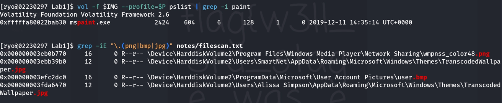
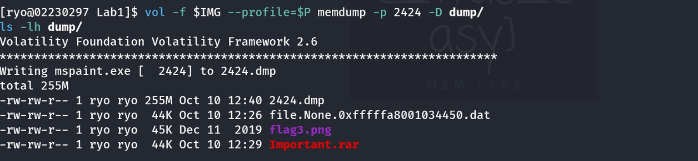
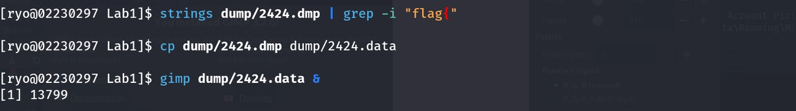
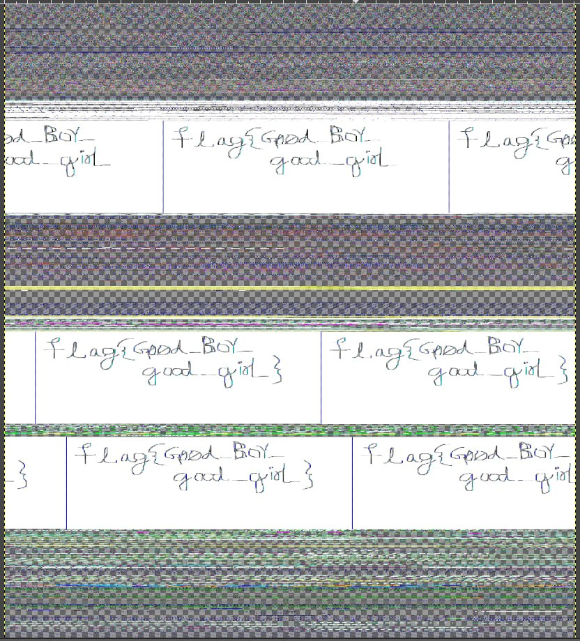

# SWS405 Digital Forensics: Assignment 2
## MemLabs Memory Forensics Challenge (Labs 1 to 5)

## Table of Contents
1. [How I Set Up and Worked](#how-i-set-up-and-worked)
2. [Lab 1: Beginner's Luck](#lab-1-beginners-luck)
3. [Lab 2: A New World](#lab-2-a-new-world)
4. [Lab 3: The Evil's Den](#lab-3-the-evils-den)
5. [Lab 4: Obsession](#lab-4-obsession)
6. [Lab 5: Black Tuesday](#lab-5-black-tuesday)
7. [Final Summary: All Flags](#final-summary-all-flags)

---

## How I Set Up and Worked

**Installing Volatility.** I started by following the assignment and tried to install Volatility with `apt`, but got an error *"Unable to locate package volatility"*. Volatility 2 is no longer in the new Kali repositories. Instead of fighting with it, I downloaded the **Volatility 2.6 standalone Linux binary** from the Volatility Foundation's GitHub releases and made a short alias `vol` for it. To test it, I listed its profiles and checked that **Win7SP1x64** was there, because most of the labs use that profile.

**Figure 0.1:** Volatility 2.6 running on my Kali VM, with the Win7SP1x64 profile available

**How I kept my work organised.** I set up the same routine for every lab:
- A separate folder for each lab, with `dump` (extracted files), `notes` (saved plugin output) and `screenshots` inside.
- Before touching any memory image, I calculated its **MD5 and SHA256 hash**. That way I can show the evidence did not change while I worked on it.
- I recorded every session with the Linux `script` tool, so I have a full log of everything I typed, including my mistakes.
- I changed my terminal prompt to `[ryo@02230297 LabX]$`, so every screenshot shows my student ID.

**Setup problems I ran into:**
- My first `script` command failed because I hadn't created the `notes` folder yet.
- When I set my prompt, it showed `\u` and `\W` literally. I learned that Kali uses **zsh**, not bash, and zsh uses a different prompt syntax.
- Right after starting `script`, Volatility said *"The requested file doesn't exist"*. `script` opens a new shell, so the variables holding my image name and profile were empty. I had to set them again.

**My method.** In every lab I tried not to jump straight to the flag. I followed the Part B checklist: scope the image: command history: environment variables: files in memory: credentials: deleted data: browser history: connect the evidence.

---
---

## Lab 1: Beginner's Luck

| | |
|---|---|
| **Evidence file** | `MemoryDump_Lab1.raw` (1.0 GB) |
| **MD5** | `b9fec1a443907d870cb32b048bda9380` |
| **SHA256** | `88e708413898c98351d1a5a221799fc34460dfecb20e482ca5247b0b113b8cf2` |
| **Profile** | Win7SP1x64 |
| **Image date/time** | 2019-12-11 14:38:00 UTC (20:08 local, +0530) |

### 1.1 What This Lab Was About
In this lab, a relative's computer crashed while the user was doing several tasks at the same time. My job was to recover the important files and work out what the user was doing at the moment of the crash. By the end of the investigation I had reconstructed the user's last few minutes on the computer. The user had run a command in the **command prompt** that printed an encoded string, had a password-protected archive called `Important.rar` open in **WinRAR**, and was drawing a picture in **MS Paint** that was never saved. I recovered all **three flags**.

### 1.2 Flags I Found

| # | Flag | Where it was hiding | Figure |
|---|------|---------------------|--------|
| 1 | `flag{th1s_1s_th3_1st_st4g3!!}` | Base64 text printed in the command prompt | 1.10 |
| 2 | `flag{w3ll_3rd_stage_was_easy}` | `flag3.png` inside `Important.rar`; the password was Alissa's NTLM hash | 1.19 |
| 3 | `flag{G00d_BoY_good_girL}` | Unsaved drawing in MS Paint's memory | 1.23 |

### 1.3 Investigation Log

#### Step 1: Preparing and Protecting the Evidence
Before running any plugin, I prepared my working folder and recorded the original state of the evidence.

**Figure 1.1:** My Lab 1 working folder

I created a separate folder for Lab 1 with three sub-folders: `dump` for extracted files, `notes` for saved plugin output and `screenshots` for my evidence pictures.

**Figure 1.2:** MD5 and SHA256 hash of the evidence

I calculated the MD5 and SHA256 hash of `MemoryDump_Lab1.raw` before starting the analysis. These hash values are the fingerprint of the original evidence. If I hash the file again at the end and get the same values, it proves that my analysis did not change the memory image.

**Figure 1.3:** Starting the session log and setting my student-ID prompt

I started recording the whole session with the `script` tool and changed my prompt to show my student ID (02230297). My first `script` command failed because the `notes` folder did not exist yet, so I created it and ran the command again. The log file now keeps a record of every command I typed, including my mistakes.

**Figure 1.4:** Saving the image name in a variable

I saved the image name in a variable so that every command used the same evidence file. Because `script` opens a new shell, I had to set this variable again after starting the log.

#### Step 2: Scoping (Which OS, and What Was Running?)
The first step of the Part B checklist was to identify the operating system and the running processes.

**Figure 1.5:** `imageinfo` suggesting the Win7SP1x64 profile

I ran `imageinfo` to find out which Windows version the memory came from and which profile Volatility should use. The first suggested profile was **Win7SP1x64**, which means the computer was running **Windows 7 Service Pack 1, 64-bit**. The memory was captured on **11 December 2019 at 14:38 UTC** (20:08 local time). I used this profile for every other command in this lab.

**Figure 1.6:** `pslist` showing the running processes

I used `pslist` to list every process that was running when the memory was captured. Most of the processes were normal Windows system processes, such as `smss.exe`, `csrss.exe`, `services.exe`, `lsass.exe`, `svchost.exe` and `explorer.exe`. The process `VBoxService.exe` showed that the computer was a **VirtualBox virtual machine**. Three processes stood out as the user's own activity: `cmd.exe` (PID 1984), `mspaint.exe` (PID 2424) and `WinRAR.exe` (PID 1512). I also saw `DumpIt.exe` (PID 796), which is a **forensic tool** used to capture the memory, so I treated it as part of the evidence collection and not as the user's activity.

**Figure 1.7:** `pstree` showing the parent and child processes

I used `pstree` to see which process started which. `WinRAR.exe` was started by `explorer.exe`, which means the user opened the archive personally, for example by double-clicking it. This gave me three leads to follow:

| Process | PID | What it suggested |
|---|---|---|
| `cmd.exe` | 1984 | The user typed something in the command prompt |
| `mspaint.exe` | 2424 | The user was drawing something |
| `WinRAR.exe` | 1512 | The user had an archive open |

#### Step 3: Flag 1 (The Command Prompt)
Since `cmd.exe` was running, I checked what the user had done in the command prompt.

**Figure 1.8:** `cmdscan` showing the typed command

I first used `cmdscan`, which reads the history of commands typed in the console. The user typed one command, **`St4G3$1`**, in `cmd.exe`. However, `cmdscan` only shows what was typed and not what the command printed, so I still did not have the full picture.

**Figure 1.9:** `consoles` showing the encoded string printed in cmd.exe

Next I used `consoles`, which shows the whole console screen, including both the input and the output. Under the command `St4G3$1`, the screen showed the output `ZmxhZ3t0aDFzXzFzX3RoM18xc3Rfc3Q0ZzMhIX0=`. The string uses only letters and numbers and ends with `=`, which is typical of **Base64** encoding. The prompt `C:\Users\SmartNet>` showed that this console belonged to the user **SmartNet**.

**Figure 1.10:** Base64 decoding of the string gives **Flag 1**

I decoded the Base64 string in my terminal. The decoded text was **Flag 1: `flag{th1s_1s_th3_1st_st4g3!!}`**.

**Figure 1.11:** The second console belonging to DumpIt

The `consoles` output also contained a second console that belonged to DumpIt. DumpIt saved the memory as `SMARTNET-PC-20191211-143755.raw`. This told me the computer's name was **SMARTNET-PC** and confirmed that the memory was captured on 11 December 2019 at 14:37:55.

#### Step 4: Flag 2 (The Locked Archive)
Next I followed the WinRAR lead to find out which archive was open.

I ran `cmdline` on WinRAR (PID 1512), which showed that it was started with the file `C:\Users\Alissa Simpson\Documents\Important.rar`. This was an important finding, because the command prompt belonged to SmartNet, so the computer had **at least two user accounts**. My first attempt at this command failed with a zsh parse error, because I typed the placeholder `<archive_manager_PID>` instead of the real PID.

**Figure 1.12:** `filescan` showing the memory offsets of Important.rar

I saved the full `filescan` output to a file and searched it for `.rar` files. `Important.rar` appeared **three times** in memory, all in Alissa Simpson's Documents folder. Each line has a different memory offset, and any of them can be used to extract the file.

**Figure 1.13:** `dumpfiles` extracting Important.rar from memory

I used `dumpfiles` with the first offset (`0x3fa3ebc0`) to copy the archive out of memory. My first attempt failed because I typed the placeholder `<offset>` again, which can be seen at the top of the screenshot. With the real offset, `dumpfiles` saved a 45 KB file, and the `file` command identified it as **RAR archive data, v5**.

**Figure 1.14:** The archive comment with the password hint

I listed the contents of the archive with `unrar`. The archive contained one file, `flag3.png`, and had the comment *"Password is NTLM hash(in uppercase) of Alissa's account passwd."* This told me exactly where to look for the password.

**Figure 1.15:** unrar asking for a password

When I tried to extract the archive, unrar asked for a password, which confirmed that the file was protected.

**Figure 1.16:** `hashdump` showing Alissa Simpson's NTLM hash

Windows keeps account password hashes in the SAM registry hive, which is loaded in memory, so I used `hashdump` to recover them. Each line has the format `user : RID : LM hash : NTLM hash`. Alissa Simpson (RID 1003) had the NTLM hash `f4ff64c8baac57d22f22edc681055ba6`. Administrator and Guest both had the hash `31d6cfe0...`, which is the well-known hash of an **empty password**. Every LM hash was `aad3b435...`, which means LM hashes were disabled, as is normal on Windows 7.

**Figure 1.17:** Extracting the archive with the uppercase NTLM hash

The hint said the password must be in **uppercase**, so I converted the hash to `F4FF64C8BAAC57D22F22EDC681055BA6` and used it as the password. The archive extracted successfully with **All OK**. My first attempt had failed with "Incorrect password", because I pasted the placeholder text instead of the real hash.

**Figure 1.18:** flag3.png in my dump folder

I listed my dump folder to confirm that `flag3.png` had been extracted.

**Figure 1.19:** flag3.png showing **Flag 2**

I opened `flag3.png` in the image viewer. The image showed **Flag 2: `flag{w3ll_3rd_stage_was_easy}`**. MemLabs calls this the "3rd stage" flag, and I needed it again later in Lab 2.

#### Step 5: Flag 3 (The Drawing in MS Paint)
This was the most challenging part of Lab 1. The story said the user was "trying to draw something", so I investigated the MS Paint process.

**Figure 1.20:** `mspaint.exe` in `pslist` and the image search in `filescan`

I confirmed the Paint process with `pslist`, and then searched the `filescan` output for `.png`, `.bmp` and `.jpg` files to see if the drawing had been saved. `mspaint.exe` (PID 2424) was started at 14:35:14 UTC, only about three minutes before the capture. The image search only found Windows system images: a Media Player icon (`wmpnss_color48.png`), two desktop wallpapers (`TranscodedWallpaper.jpg`) and the default user picture (`user.bmp`). There was **no saved drawing**, so this was a dead end, and the picture could only exist inside Paint's memory.

**Figure 1.21:** `memdump` of mspaint.exe

I used `memdump` on PID 2424 to save all the memory used by Paint into one file. The dump file `2424.dmp` was **255 MB**. This file contains everything Paint had in RAM, including the canvas.

**Figure 1.22:** Searching the dump for text, then opening it in GIMP

I first searched the dump for the text `flag{`. When that found nothing, I copied the dump to `2424.data` and opened it in GIMP as raw image data. The text search returned **no result**, which was another dead end. This makes sense because a drawing is stored as **pixels**, not as text. The `.data` extension made GIMP offer its raw image data import. My GIMP version did not have the "Image Type" option from the tutorials. In the newer GIMP it is called **Pixel format**, so I chose **RGB Alpha (RGBA 8-bit)** and left the palette settings at their defaults, because they only matter for indexed-colour images. I moved the **offset** slowly until white areas with handwriting appeared, and then changed the **width** until the writing was straight instead of slanted. GIMP printed a warning in the terminal (`Procedure 'file-raw-load': no mnemonic for property data-type`), but the import still worked.

**Figure 1.23:** Paint's raw memory in GIMP showing **Flag 3**

This is the raw memory of `mspaint.exe` displayed as an image in GIMP. The unsaved drawing showed **Flag 3: `flag{G00d_BoY_good_girL}`**. The handwriting appeared several times in the image, because Paint keeps more than one copy of the canvas in memory (the visible canvas and its undo/redraw buffers). Every copy shows the same flag.

### 1.4 Why These Plugins Worked (Forensic Reasoning)

**Flag 1 (`consoles` instead of `cmdscan`):** In Windows 7, every command prompt window is managed by `conhost.exe`, which keeps both the **command history** and the **screen buffer** in memory. `cmdscan` only reads the command history, so it showed `St4G3$1` but not the result. `consoles` also reads the screen buffer, so it showed what the command printed. The flag was in the **output**, which is why `consoles` was the right tool.

**Flag 2 (`filescan`, `dumpfiles` and `hashdump`):** When a program opens a file, Windows creates a file object and caches the file's data in RAM. `filescan` finds these file objects and `dumpfiles` copies the cached data out, which is how I recovered `Important.rar` without the hard disk. For the password, Windows keeps the **SAM** hive (which stores the password hashes) and the **SYSTEM** hive (which holds the key to decrypt them) loaded in memory. That is why `hashdump` could recover Alissa's NTLM hash directly from RAM.

**Flag 3 (`memdump`):** The drawing was never saved, so there was no file object for `filescan` to find. While Paint is open, the canvas is stored in the process's memory as raw pixels. `memdump` saved that memory, and GIMP displayed the bytes as pixels. The width has to match the canvas width, otherwise the lines come out slanted. Searching with `strings` could never work, because a picture is not text.

---
---

## Lab 2: A New World

| | |
|---|---|
| **Evidence file** | `MemoryDump_Lab2.raw` |
| **MD5** | `ddb337936a75153822baed718851716b` |
| **SHA256** | `33d76b29683b38875d7a49bf91c23c58a72d0e1772e89f1b5ce19c25eccb9809` |
| **Profile** | Win7SP1x64 |
| **Image date/time** | 2019-12-14 10:38:46 UTC (16:08 local, +0530) |

### 2.1 What This Lab Was About
This Windows 7 computer had **Google Chrome** and the **KeePass** password manager open. I found three flags:
1. A Base64 string disguised as a folder path inside a **fake environment variable**, `NEW_TMP`.
2. A password in the **Recycle Bin of a KeePass database**. The master password was written on a picture in a different user's folder.
3. A picture in a zip file behind a **mega.nz link** in Chrome's history. The zip was locked with the **SHA1 hash of my Lab 1 stage-3 flag**, so I needed Lab 1 to finish Lab 2.

### 2.2 Flags I Found

| # | Flag | Where it was hiding | Figure |
|---|------|---------------------|--------|
| 1 | `flag{w3lc0m3_T0_$T4g3_!_Of_L4B_2}` | `NEW_TMP` environment variable (Base64) | 2.10 |
| 2 | `flag{w0w_th1s_1s_Th3_SeC0nD_ST4g3_!!}` | KeePass database → Recycle Bin → entry "Sabka Baap" | 2.17 |
| 3 | `flag{oK_So_Now_St4g3_3_is_DoNE!!}` | `Important.png` from the mega.nz zip | 2.24 |

### 2.3 Investigation Log

#### Step 1: Preparing and protecting the evidence

**Figure 2.1:** Starting my session log, setting my student-ID prompt, and recording the date and user

**Figure 2.2:** MD5 and SHA256 hash of the Lab 2 evidence

#### Step 2: Scoping (Which OS, and What Was Running?)
`imageinfo` again suggested **Win7SP1x64** (Windows 7 SP1, 64-bit). The memory was captured on **14 December 2019 at 10:38 UTC**.

**Figure 2.3:** `imageinfo`: profile and capture time

**Figure 2.4:** `pslist`: running processes

**Figure 2.5:** `pstree`: the process tree

**Figure 2.6:** The two applications that stood out: Chrome and KeePass

**What I noticed:**
- There were **six `chrome.exe` processes** (PIDs 2296, 2304, 2476, 2964, 2572, 1632). Chrome uses one main process (2296) and a separate child process for each tab or extension, which is why all the others had 2296 as their parent. This was the **browsing session**.
- **`KeePass.exe` (PID 3008)** was started at 10:37:56, only about a minute before the capture. This was the **password manager**.
- Following the guidance, I investigated each of them separately.

#### Step 3: Flag 1 (Environment Variables)
The guidance said to check environment variables early. `envars` gave me **1,704 lines**, which was far too many to read by eye. So I saved the output and counted how many times each variable **name** appeared, expecting anything unusual to show up as rare or strange.

**Figure 2.7:** `envars` saved to a file: 1,704 lines

**Figure 2.8:** Counting variable names to spot anything unusual

**What I noticed:**
- The rare names all turned out to be normal: `MpConfig_*` is Windows Defender, `CHROME_RESTART` and `CHROME_CRASHPAD_PIPE_NAME` come from Chrome, and `OANOCACHE` and `PROMPT` are standard Windows variables.
- One name I didn't recognise was **`NEW_TMP`**. It isn't a real Windows variable; it imitates `TEMP` and `TMP`. It appeared about as often as `TEMP` and `TMP`, which meant it had been set **system-wide**. It was even inside system processes like `csrss.exe`, `winlogon.exe` and `wininit.exe`.

**Figure 2.9:** `NEW_TMP`: it looks like a folder path, but the end is Base64

The value looked like a path, `C:\Windows\ZmxhZ3t3...`, but I recognised `Zmxh` from Lab 1: it is Base64 for `fla`. I decoded the last part and got the first flag.

**Figure 2.10:** Base64 decoded: **Flag 1: `flag{w3lc0m3_T0_$T4g3_!_Of_L4B_2}`**

#### Step 4: Flag 2 (The KeePass Database)
KeePass databases use the **`.kdbx`** extension, so I searched my `filescan` output for it. I found **`Hidden.kdbx`** in `C:\Users\SmartNet\Secrets\`.

**Figure 2.11:** `filescan`: Hidden.kdbx in SmartNet's "Secrets" folder

I needed the master password, and the guidance said it would **not** be sitting next to the database. So I searched the whole file list for "password". Most of the results were KeePass's own program files. One was different: **`Password.png`** in **Alissa Simpson's** Pictures folder, a different user from the one who owned the database.

**Figure 2.12:** Searching for "Secrets" and "password": Password.png in another user's folder

I extracted both files with `dumpfiles` and checked them with `file`. One was a **KeePass 2.x database** and the other a **PNG image (1587 × 2245)**. I renamed both to their real names.

**Figure 2.13:** Both files extracted from memory and identified

**Figure 2.14:** Renamed to Hidden.kdbx and Password.png

At first the picture looked like a joke: *"WOW! YOU ARE HERE!! BUT THE FLAG IS NOT HERE!! :P"*. When I zoomed into the bottom-right corner, there was tiny text: **"Psst!! password is P4SSw0rd_123"**. That was the KeePass master password.

**Figure 2.15:** Password.png: the master password `P4SSw0rd_123` in the bottom-right corner

**Dead end: `hashdump`.** Because the checklist says to check credentials, I also ran `hashdump`. The hashes were **exactly the same as in Lab 1**, which showed me that Lab 1 and Lab 2 came from the **same computer**. But KeePass uses its own master password, not the Windows password, so these hashes didn't help me open the database.

Using `P4SSw0rd_123`, I unlocked the database with KeePassXC's command-line tool. It had the usual groups (General, Windows, Network, Internet, eMail, Homebanking) and a **Recycle Bin**. The Recycle Bin had three entries: `Sample Entry` and `Sample Entry #2`, which are KeePass's default examples, and **`Sabka Baap`**, which the user must have created.

**Figure 2.16:** `hashdump` (dead end), then the KeePass groups and the Recycle Bin entries

*Mistake:* my first two attempts to open the entry failed with "Could not find entry", because I typed a placeholder instead of the real name.

When I opened `Sabka Baap`, the **username was "Flag"** and the **password was the second flag**.

**Figure 2.17:** The deleted KeePass entry "Sabka Baap": **Flag 2: `flag{w0w_th1s_1s_Th3_SeC0nD_ST4g3_!!}`**

#### Step 5: Flag 3 (Chrome History and My Lab 1 Flag)
**Dead end: the `chromehistory` plugin wouldn't load.** I downloaded the community plugin pack, but Volatility just said *"You must specify something to do"*. When I checked why, the real error was **`ImportError: No module named csv`**. The standalone Volatility binary comes with its own Python, and that Python doesn't include the `csv` module. I also tried a patched copy of the plugin, and it still didn't work.

**My workaround: reading Chrome's history myself.** I knew Chrome stores its history in an **SQLite database file called `History`**. Chrome was open, so that file was in `filescan`.
- I extracted it with `dumpfiles`. This gave me two files: the real 118 KB data file and an **empty `.vacb` file** (a cache-map copy with no data).
- My first try failed: `sqlite3` said "no such table: urls" because I had copied the wrong file.
- With the right file, I read the `urls` table and found a **mega.nz** link: `https://mega.nz/#F!TrgSQQTS!H0ZrUzF0B-ZKNM3y9E76lg`

**Figure 2.18:** Reading Chrome's History database with sqlite3: the mega.nz link

The link opened a MEGA folder called **"MemLabs_Lab2_Stage3"** with one file, `Important.zip`, which I downloaded.

**Figure 2.19:** The MEGA folder with Important.zip

*Problem:* when I first tried to list the zip, it couldn't be found, because the download hadn't actually finished. When I downloaded it again, I found the zip had **another `Important.zip` inside it**. I extracted the inner zip into a separate `mega` folder, and I chose **not** to overwrite my original download.

**Figure 2.20:** The downloaded zip contained another Important.zip

The inner zip had a comment:
> *"Password is SHA1(stage-3-FLAG) from Lab-1. Password is in lowercase."*

**Dead end: I hashed the wrong flag.** On my first try I mixed up the flags and hashed my Lab 2 Flag 1 instead of the Lab 1 stage-3 flag. That gave `25761e0a…`, and 7-Zip said **Wrong password**. 7-Zip still created a **0-byte `Important.png`**, which taught me that a file appearing doesn't mean the extraction worked.

**Figure 2.21:** Dead end: SHA1 of the wrong flag (`25761e0a…`)

Then I used the right flag, the stage-3 flag from Lab 1, `flag{w3ll_3rd_stage_was_easy}`. Its SHA1 was **`6045dd90029719a039fd2d2ebcca718439dd100a`**. 7-Zip accepted it and asked to replace the 0-byte file with the real **59,291-byte** image, and I said yes.

**Figure 2.22:** The correct SHA1 of my Lab 1 flag, and the zip comment

**Figure 2.23:** Extraction succeeded ("Everything is Ok"): Important.png is 59,291 bytes

**Figure 2.24:** Important.png: **Flag 3: `flag{oK_So_Now_St4g3_3_is_DoNE!!}`**

### 2.4 How I Worked Out the Final Archive Password
The zip comment said the password is **the SHA1 of the stage-3 flag from Lab 1, in lowercase**. The stage-3 flag from Lab 1 is the one in `flag3.png`: `flag{w3ll_3rd_stage_was_easy}`. This is how I turned it into the password:
- I hashed the **whole flag exactly as written**, including `flag{` and `}`, using **SHA1**.
- I made sure **no newline** was added at the end. A hidden newline changes the input, and the hash would come out completely different.
- `sha1sum` already prints its result in **lowercase hex**, which is what the comment asked for, so I didn't need to change the case.

The password was `6045dd90029719a039fd2d2ebcca718439dd100a`. My first attempt with the wrong flag failed, which showed me how exact the input has to be.

### 2.5 Why These Techniques Worked (Forensic Reasoning)
- **`envars`:** Every Windows process keeps its own copy of the environment variables in its **Process Environment Block (PEB)** in memory. `envars` reads all of them, so it found `NEW_TMP` even though nothing ever displayed it. Because system processes like `csrss.exe` had it too, I knew it had been set for the whole system.
- **KeePass:** KeePass had `Hidden.kdbx` open, so Windows had the file cached in RAM, and `filescan` + `dumpfiles` could get it back. "Deleting" an entry in KeePass only moves it to the **Recycle Bin group inside the same file**, so the flag was still in the database.
- **Chrome history:** Volatility 2 has no built-in Chrome plugin. When the community plugin failed, I did by hand what the plugin does internally: I found Chrome's SQLite `History` file in memory, extracted it, and read the `urls` table.

---
---

## Lab 3: The Evil's Den

| | |
|---|---|
| **Evidence file** | `MemoryDump_Lab3.raw` (1000 MB) |
| **MD5** | `ce4e7adc4efbf719888d2c87256d1da3` |
| **SHA256** | `a43797b924f7de2629dc466f61e3c7edff1484e9ad6ac702bddd4c9d5f4be1e5` |
| **Profile** | Win7SP1x86_23418 (**32-bit**) |
| **Image date/time** | 2018-09-30 09:47:54 UTC (15:17 local, +0530) |

### 3.1 What This Lab Was About
A malicious Python script had encoded a secret, and the flag was split into two halves:
- I recovered the script and its output file from memory and read the code. It **XORs every character with 3 and then Base64-encodes** the result. By reversing those steps, I got the **first half**.
- The **second half** was hidden inside a JPEG with **steghide**, and the passphrase was the first half.

### 3.2 Flag I Found

| Part | Value | Figure |
|---|---|---|
| First half | `inctf{0n3_h4lf` | 3.12 |
| Second half | `_1s_n0t_3n0ugh}` | 3.18 |
| **Full flag** | **`inctf{0n3_h4lf_1s_n0t_3n0ugh}`** | 3.19 |

### 3.3 Investigation Log

#### Step 1: Getting and protecting the evidence

**Figure 3.1:** Extracting the Lab 3 archive (243 MB → 1000 MB raw image)

**Figure 3.2:** Starting my session log with my student-ID prompt

**Figure 3.3:** MD5 and SHA256 hash of the evidence

#### Step 2: Scoping (Which OS, and What Was Running?)
This lab was different. `imageinfo` suggested **Win7SP1x86_23418**, a **32-bit** Windows 7, while Labs 1 and 2 were 64-bit. I had to change my profile, because Volatility needs the right profile to know where Windows keeps its internal structures in memory. The capture time was **30 September 2018, 09:47 UTC**.

**Figure 3.4:** `imageinfo`: a 32-bit (x86) profile this time

**Figure 3.5:** Process list: two `notepad.exe` processes

**What I noticed:**
- There were **two `notepad.exe` processes** (PIDs **3736** and **3432**), started one second apart (09:47:49 and 09:47:50), just a few seconds before the capture. Both had the same parent (5300). This matched the "text-editing process" in the guidance.
- `DumpIt.exe` was running from the user **hello**'s Desktop. Again, that is the memory capture tool, not the user's activity.

#### Step 3: Which files was Notepad editing?
`cmdline` showed which file each Notepad was opened with:
- Notepad 1 → `C:\Users\hello\Desktop\evilscript.py`, the **script**
- Notepad 2 → `C:\Users\hello\Desktop\vip.txt`, its **output**

**Figure 3.6:** `cmdline`: Notepad had evilscript.py and vip.txt open

Following the checklist, I also ran `cmdscan` and `consoles`. They only showed the DumpIt console and some unreadable garbage, with no useful commands, so that was a dead end.

#### Step 4: Finding and extracting the two files
`filescan` listed **7,117** file objects, so I filtered for the two names and found:
- `\Users\hello\Desktop\evilscript.py.py`, opened read-only (`R--`)
- `\Users\hello\Desktop\vip.txt`, opened for **writing** (`-W-`)

**Figure 3.7:** `filescan`: evilscript.py.py and vip.txt on hello's Desktop

**What I noticed:**
- The real file name was **`evilscript.py.py`**, with a **double extension**. This often happens when Windows hides file extensions and the user types `.py` again.
- The access flags matched the story: the script was **read**, and `vip.txt` was **written to**, because the script saved its result there.

I extracted both files with `dumpfiles` into separate folders, so they wouldn't get mixed up.

**Figure 3.8:** Extracting the script and the output file from memory

**Figure 3.9:** Both files extracted and renamed

#### Step 5: Reading the script (I did not run it)
I decided to **read the code instead of running it**. It was a malicious file from the evidence, and running unknown code could damage my machine or change my evidence.

**Figure 3.10:** The source code of evilscript.py.py

**What the script does, step by step:**
1. It takes a secret from the **command line** (`sys.argv[1]`).
2. The `xor()` function changes every character by **XOR-ing it with the number 3**.
3. The `encoder()` function turns the result into **Base64** (this is Python 2 style).
4. It writes the result into `C:\Users\hello\Desktop\vip.txt`.

The code calls `encoder(xor(arr))`, and the inner function runs first, so the order is **XOR first, then Base64**.

#### Step 6: First Half (Undoing the Script)
`vip.txt` contained `am1gd2V4M20wXGs3b2U=`.

*Problem:* when I first decoded it, I got some output followed by **"base64: invalid input"**. After some thought I worked out why: `dumpfiles` saves whole memory pages (4,096 bytes), so the rest of this tiny file was filled with **null bytes**. I kept only the real first line and removed the padding.

**Figure 3.11:** The encoded content of vip.txt, and the "invalid input" problem

To undo the script, I did its steps **backwards**: **Base64-decode first, then XOR with 3**. That gave me the **first half: `inctf{0n3_h4lf`**.

**Figure 3.12:** Base64 decode + XOR 3: **first half `inctf{0n3_h4lf`**

**Figure 3.13:** Decoding the cleaned-up file

To be sure I understood it properly, I also wrote **my own reversing script, `reverse.py`**. It:
1. reads the output file,
2. strips out the null padding,
3. Base64-decodes the text,
4. XORs every byte with 3.

It printed the same first half.

**Figure 3.14:** My own `reverse.py` and its output

#### Step 7: Second Half (Steganography)
The task mentioned steganography, so I searched `filescan` for photo files (`.jpg` and `.jpeg`).

**Figure 3.15:** Image files in memory: one of them doesn't fit

**What I noticed:**
- Almost every JPEG was in `Temporary Internet Files\Content.IE5\`, with random names like `BBNIP4D[1].jpg`. These are just Internet Explorer's cached web images.
- **One file stood out: `suspision1.jpeg` on hello's Desktop.**
  - It was in the user's own folder, not a cache folder.
  - It used `.jpeg` instead of `.jpg`.
  - Its name is a misspelling of "suspicion".
  - It was opened read/write (`RW`).

I extracted it with `dumpfiles` and checked that it was a real JPEG.

**Figure 3.16:** suspision1.jpeg extracted from memory

For the passphrase I went back to the lab's description. **Note-2** says you need the first half of the flag to get the second half. So the natural passphrase to try was the first half itself, **`inctf{0n3_h4lf`**.

**Figure 3.17:** The Lab 3 description with the Note-2 hint

steghide accepted the passphrase and wrote the hidden data to `secret.txt`, which contained the **second half: `_1s_n0t_3n0ugh}`**.

**Figure 3.18:** steghide extraction using the first half as the passphrase: **second half**

Putting both halves together gave me the complete flag.

**Figure 3.19:** **Full flag: `inctf{0n3_h4lf_1s_n0t_3n0ugh}`**

### 3.4 What the Script Did and How I Reversed It
The script took a secret from the command line and changed it in two steps:
1. **XOR with 3:** each character's number was XOR-ed with 3, so for example `i` (105) became `j` (106).
2. **Base64-encode:** the result was turned into Base64 text and saved in `vip.txt`.

To undo it, I did the opposite steps **in reverse order**:
1. **Base64-decode** the text from `vip.txt`.
2. **XOR every byte with 3 again.** XOR cancels itself out when you use the same key: `(a XOR 3) XOR 3 = a`.

My `reverse.py` (Figure 3.14) does exactly this, and it also removes the null-byte padding that `dumpfiles` added.

### 3.5 Why These Techniques Worked (Forensic Reasoning)
- **`cmdline`** shows how each process was started. For Notepad, that includes the file it opened, so it led me straight to the script and its output.
- **`filescan` + `dumpfiles`** recovered both files because Windows still had them cached in memory. The access flags (`R` vs `W`) even showed me which file was read and which one was written.
- **Steganography** hides data inside an image without visibly changing it, so the JPEG looked completely normal. steghide needs the right passphrase, and Note-2 told me the first half was that key.

---
---

## Lab 4: Obsession

| | |
|---|---|
| **Evidence file** | `MemoryDump_Lab4.raw` |
| **MD5** | `b0dd82624c51d4b2d689ba38812aa9e1` |
| **SHA256** | `53289a00f74397798928603356c81ae9d3cd3aff009472307e9d364fad252c49` |
| **Profile** | Win7SP1x64 |
| **Image date/time** | 2019-06-29 07:30:00 UTC (13:00 local, +0530) |

### 4.1 What This Lab Was About
In this lab the important file had been **deleted**, and it took several steps to get to it:
- First I had to work around a **broken process list**.
- Then I checked a suspicious image, `galf.jpeg` ("flag" backwards). It turned out to be a **decoy**.
- The real evidence was `Important.txt`. It had **no file object** left in memory, so `dumpfiles` couldn't recover it.
- Its content was still inside its **NTFS Master File Table (MFT) record**, and `mftparser` gave me the flag from there.

### 4.2 Flag I Found

| Flag | Where it was hiding | Figure |
|---|---|---|
| `inctf{1_is_n0t_EQu4l_7o_2_bUt_th1s_d0s3nt_m4ke_s3ns3}` | Resident `$DATA` in the MFT record of the deleted `Important.txt` | 4.15, 4.16 |

### 4.3 Investigation Log

#### Step 1: Preparing and protecting the evidence

**Figure 4.1:** Starting Lab 4

**Figure 4.2:** The Lab 4 description

**Figure 4.3:** MD5 and SHA256 hash of the evidence

#### Step 2: Scoping (Which OS, and What Was Running?)
`imageinfo` suggested **Win7SP1x64** (Windows 7 SP1, 64-bit). The capture time was **29 June 2019, 07:30 UTC**.

**Figure 4.4:** `imageinfo`

**Problem: the process list didn't work.** When I ran `pslist` and `pstree`, both failed with *"Could not list tasks, please verify your --profile with kdbgscan"*. This hadn't happened in the earlier labs.

**Figure 4.5:** `pslist` failing: "Could not list tasks"

I learned that `pslist` works by finding a kernel structure called the **KDBG** and then following the list of processes it points to. I ran `kdbgscan` to check it. It found **only one KDBG** (at physical offset `0x27f60a0`), so there was no better copy I could switch to, and the process list it pointed to wasn't usable.

**Figure 4.6:** `kdbgscan`: only one KDBG found

**My workaround: `psscan`.** Instead of following that linked list, `psscan` scans all of memory for process structures by their **pool tag** (a small label Windows puts on each memory allocation). This worked.

**Figure 4.7:** `psscan`: the process list recovered by scanning

**What I noticed:**
- **`explorer.exe` (PID 1944)** was the user's desktop.
  - It had started **`VBoxTray.exe`**, so this was a **VirtualBox VM**.
  - It had also started **`DumpIt.exe`**, the capture tool.
- **`GoogleCrashHandler`** processes told me Chrome was installed.
- `csrss.exe` (2672) and `LogonUI.exe` (2148) had **exit times** (07:29:59). `psscan` can find processes that have already ended, and `pslist` can't.
- There were **no user programs** open (no Notepad, WinRAR or Paint). So I decided the evidence had to be in the **files**, not in a running program.

#### Step 3: Looking at the Desktop files
I searched my `filescan` output for "desktop".

**Figure 4.8:** Desktop files and Important.lnk in `filescan`

**What I noticed:**
- There were two users: **`eminem`** and **`SlimShady`**.
- **`galf.jpeg`** on eminem's Desktop is "flag" spelled backwards, which already felt like a trick.
- `Screenshot1.png` was also on the Desktop.
- **`2PAC-20190629-072925.raw`** was DumpIt's output file, so the computer's name was **2PAC**.
- **`Important.txt` was not in `filescan` at all.** The only trace of it was **`Important.lnk`** in SlimShady's `Recent` folder. Windows creates these shortcuts automatically when a user **opens** a file. So I knew `Important.txt` had existed and had been opened, even though its file object was gone.

#### Step 4: Dead End (The Steganography Image)
I extracted `galf.jpeg` with `dumpfiles` (229 KB).

*Mistake:* my first attempt to open it failed with "No such file or directory", because I had forgotten to rename the dumped file first. Once I renamed it, it opened fine.

**Figure 4.9:** Extracting galf.jpeg from memory

**Figure 4.10:** galf.jpeg identified as a JPEG

**Figure 4.11:** The galf.jpeg picture

Then I ran the basic steganography checks on it:
- **exiftool:** the metadata was normal.
- **strings:** no "inctf", "flag" or "pass" text.
- **binwalk:** only normal JPEG data, with nothing hidden at the end.
- **steghide with an empty passphrase:** it did extract a small hidden message: ***"Move on bro, there is nothing here :)"***

**Figure 4.12:** The stego checks: the hidden message tells me to move on (dead end)

**Why I moved on, and why I still recorded it:** the image's own hidden message confirmed it was a **decoy**, so I stopped spending time on it. I still wrote it down, because it shows I **checked the image and ruled it out on purpose**, rather than ignoring it. Anyone reviewing my work can see it was tested and won't need to repeat it. A good investigation records what was **not** found as well as what was.

#### Step 5: Trying to dump Important.txt the normal way (it failed)
`Important.txt` had no `filescan` offset, so I asked `dumpfiles` to search for it **by name** instead. **Nothing was extracted.**

**Figure 4.13:** `dumpfiles` on Important.txt: nothing recovered

At this point I realised what that meant: the file had been **deleted**, so its file object and cached data were no longer in RAM. `dumpfiles` can only copy what is cached in memory, so it had nothing to copy.

#### Step 6: Recovering the file from the MFT (the flag)
Following the guidance, I ran `mftparser` (it took about 19 seconds), saved the output, and searched it for "Important.txt".

**Figure 4.14:** Running `mftparser` and finding the Important.txt record

The record belonged to **`Users\SlimShady\Desktop\Important.txt`**, created on **27 June 2019 at 13:14 UTC**, two days before the capture. The file was small, so its **content was stored inside the MFT record itself** (resident `$DATA`). In the hex dump I could see the flag, but it was broken up by lots of line breaks (`0d 0a`). The author had pressed Enter many times between the pieces of the flag to make it harder to read.

**Figure 4.15:** The MFT record of Important.txt: the flag inside the resident `$DATA`

I turned the hex back into text and removed the line breaks, which gave me the clean flag. The text after it, `Good work :P`, is a message from the author, not part of the flag.

**Figure 4.16:** **Flag: `inctf{1_is_n0t_EQu4l_7o_2_bUt_th1s_d0s3nt_m4ke_s3ns3}`**

### 4.4 Why `dumpfiles` Failed but `mftparser` Worked
`dumpfiles` does not read the hard disk. It copies a file's **cached data from RAM**, and it finds that data through the file's **file object** (the same objects `filescan` lists). Once `Important.txt` was deleted, its file object and cached pages disappeared from memory. That is why it was missing from `filescan` and why `dumpfiles` had nothing to copy. Only the `Important.lnk` shortcut showed the file had ever existed.

NTFS works differently. It keeps a **1 KB record for every file in the Master File Table (MFT)**. For **small files (under about 700 bytes), the actual content is stored inside that record** ("resident" data). When a file is deleted, NTFS only marks its MFT record as "free", and the bytes stay there until something overwrites them. This record was still cached in RAM. `mftparser` searches memory for MFT records by their `FILE` signature, so it found the record and the content inside it.

**What I took away:** a file missing from a file listing doesn't mean its content is gone. Different traces of a file survive deletion in different ways.

---
---

## Lab 5: Black Tuesday

| | |
|---|---|
| **Evidence file** | `MemoryDump_Lab5.raw` (1.0 GB) |
| **MD5** | `9dd6cb1134c9b018020bad44f27394db` |
| **SHA256** | `08725b77ed2a447b128e12c031c17db4524f36920db791e27452b5d9165ff83a` |
| **Profile** | Win7SP1x64 |
| **Image date/time** | 2019-12-20 03:47:57 UTC (09:17 local, +0530) |

### 5.1 What This Lab Was About
WinRAR had a password-protected archive open, and its name, `SW1wb3J0YW50`, turned out to be Base64 for **"Important"**.
- Instead of brute-forcing the password, I looked at the **Internet Explorer / Windows Explorer history** with the built-in `iehistory` plugin.
- It showed the user had opened a `.bmp` file with a very long, **Base64-encoded name**.
- Decoding that name gave me **Flag 1**, which was also the **archive password**.
- The archive contained **Flag 2**.

### 5.2 Flags I Found

| # | Flag | Where it was hiding | Figure |
|---|------|---------------------|--------|
| 1 | `flag{!!_w3LL_d0n3_St4g3-1_0f_L4B_5_D0n3_!!}` | Encoded file name in the IE/Explorer history | 5.15 |
| 2 | `flag{W1th_th1s_$taGe_2_1s_c0mPL3T3_!!}` | `Stage2.png` inside the RAR, opened with Flag 1 | 5.18 |

### 5.3 Investigation Log

#### Step 1: Getting and protecting the evidence
*Problem:* my first download of the lab archive was **0 bytes**, and 7-Zip said *"Cannot open the file as archive"*. I downloaded it again and checked the file size before extracting it.

**Figure 5.1:** The Lab 5 description

**Figure 5.2:** Getting the Lab 5 image

**Figure 5.3:** MD5 and SHA256 hash of the evidence

#### Step 2: Scoping (Which OS, and What Was Running?)
`imageinfo` suggested **Win7SP1x64** (Windows 7 SP1, 64-bit). The capture time was **20 December 2019, 03:47 UTC**.

**Figure 5.4:** `imageinfo`

**Figure 5.5:** The key processes: WinRAR, several Notepads and DumpIt

**What I noticed:**
- **`WinRAR.exe` (PID 2924)**, started at 03:47:13, was the **archive manager**.
- There were **four Notepad processes** (PIDs 2744, 2724, 1388, 2056).
- **`DumpIt.exe` (PID 2208)** was the capture tool. Its console showed the computer was **SMARTNET-PC** again, the same machine as in Labs 1 and 2.
- They all had the same parent (1580), the user's desktop. **No browser was running.** As the guidance said, nothing looked suspicious on its own.

#### Step 3: The locked archive
I pulled WinRAR's PID out of my saved process list, then used `cmdline` on it. It had been opened with **`C:\Users\SmartNet\Documents\SW1wb3J0YW50.rar`**.

**Figure 5.6:** Finding the WinRAR PID (2924)

**Figure 5.7:** `cmdline`: WinRAR had SW1wb3J0YW50.rar open

The name didn't look like a real word. After Labs 1 and 2 I recognised the style, so I tried decoding it as Base64. It means **"Important"**, so someone had disguised the name.

**Figure 5.8:** The archive name decoded: "Important"

I found the archive in `filescan` and extracted it with `dumpfiles`. `file` confirmed it was **RAR archive data, v5** (77,824 bytes).

**Figure 5.9:** `filescan`: the archive in SmartNet's Documents

**Figure 5.10:** The archive extracted from memory: RAR v5

Inside was one file, **`Stage2.png`** (83,274 bytes), and it **asked for a password** straight away.

**Figure 5.11:** The archive contains Stage2.png and needs a password

**I didn't brute-force it.** It could take forever, it might never work, and it wouldn't explain anything forensically. The guidance said the password was somewhere else in memory, so I went looking for it.

I also tried `cmdscan`, but it only showed the DumpIt console with no useful commands, so that was another dead end.

#### Step 4: Flag 1 (Browser History)
In Lab 2 I used Chrome history, but this computer had no Chrome. So I used Volatility's **built-in `iehistory`** plugin, which reads Internet Explorer's history.

*Dead end:* the output was only **6 lines**, and my search for "Location" found **nothing**. At first I thought the plugin had failed.

**Figure 5.12:** `iehistory`: only 6 lines, and my "Location" search found nothing

Instead of giving up, I read the whole output. The record was a **"DEST"** type entry, and DEST entries use `URL:` instead of `Location:`. That was why my search missed it.

**Figure 5.13:** The DEST record with a very long encoded file name

**What I noticed:**
- The record belonged to **`explorer.exe` (PID 1396)** and the user **Alissa Simpson**, not SmartNet, who owned the archive.
- It was a **`file:///`** path, so it was a **local file**, not a website.
- The file was hidden in **`C:\Windows\AppPatch\`**, a system folder where nobody would normally look.
- The file name was **very long**, ended in `.bmp`, and started with **`Zmxh`**, which I now knew was Base64 for `fla`.

Base64 text has to be a multiple of 4 characters long, but the `=` padding had been stripped from the file name. I added the missing `==` back and then decoded it.

**Figure 5.14:** Adding the missing `==` padding back

**Figure 5.15:** The decoded file name: **Flag 1: `flag{!!_w3LL_d0n3_St4g3-1_0f_L4B_5_D0n3_!!}`**

#### Step 5: Flag 2 (Opening the Archive)
I used Flag 1 as the archive password, and unrar extracted `Stage2.png` with **All OK**.

**Figure 5.16:** The archive opened with Flag 1: All OK

**Figure 5.17:** Stage2.png extracted (83,274 bytes)

**Figure 5.18:** Stage2.png: **Flag 2: `flag{W1th_th1s_$taGe_2_1s_c0mPL3T3_!!}`**

### 5.4 The Browser-History Plugin I Used
I used Volatility's **built-in `iehistory`** plugin, because this system recorded its history in **Internet Explorer / WinINet `index.dat`** cache records (Windows Explorer uses the same system), and `iehistory` finds those records in process memory. The community **`chromehistory`** plugin I tried in Lab 2 only reads **Chrome's SQLite `History`** database, so it wouldn't have found these records.

### 5.5 Why This Worked (Forensic Reasoning)
- `iehistory` doesn't only show websites. Windows Explorer uses the same WinINet history system, so it also recorded that a **local file** (`file:///…bmp`) had been opened. Browser-history traces can therefore reveal files a user touched, even when the file itself is gone.
- The encoded file name looked like random text until I decoded it. Base64 hides data from a quick glance, but not from someone actually looking.
- This lab was a **chain of evidence**: process (WinRAR) → the archive it had open → a history record from Explorer → the decoded file name → the password → the second flag. No single piece was enough on its own; I only got the answer by **connecting them**.

---
---

## Final Summary: All Flags

| Lab | Flag | How I found it |
|---|---|---|
| Lab 1 | `flag{th1s_1s_th3_1st_st4g3!!}` | `consoles` → Base64 |
| Lab 1 | `flag{w3ll_3rd_stage_was_easy}` | `cmdline` → `filescan` → `dumpfiles` → `hashdump` → unrar |
| Lab 1 | `flag{G00d_BoY_good_girL}` | `memdump` of mspaint → GIMP raw image |
| Lab 2 | `flag{w3lc0m3_T0_$T4g3_!_Of_L4B_2}` | `envars` → `NEW_TMP` → Base64 |
| Lab 2 | `flag{w0w_th1s_1s_Th3_SeC0nD_ST4g3_!!}` | `filescan` → `dumpfiles` → KeePass Recycle Bin |
| Lab 2 | `flag{oK_So_Now_St4g3_3_is_DoNE!!}` | Chrome History → mega.nz → SHA1(Lab 1 flag) |
| Lab 3 | `inctf{0n3_h4lf_1s_n0t_3n0ugh}` | `cmdline` → `dumpfiles` → reverse XOR/Base64 → steghide |
| Lab 4 | `inctf{1_is_n0t_EQu4l_7o_2_bUt_th1s_d0s3nt_m4ke_s3ns3}` | `psscan` → `filescan` → `mftparser` |
| Lab 5 | `flag{!!_w3LL_d0n3_St4g3-1_0f_L4B_5_D0n3_!!}` | `iehistory` → Base64 file name |
| Lab 5 | `flag{W1th_th1s_$taGe_2_1s_c0mPL3T3_!!}` | `dumpfiles` → unrar with Flag 1 |

### What I Learned
- **Memory holds far more than a list of running programs.** In these five labs I recovered console output, environment variables, cached files, password hashes, browser history, MFT records of deleted files, and even a drawing that was never saved.
- **Every plugin reads a different kind of trace.** When a plugin failed (`pslist` in Lab 4, `chromehistory` in Lab 2), understanding *how* it works let me reach the same evidence another way: `psscan`, or reading Chrome's SQLite file myself.
- **Dead ends and mistakes are part of the work.** The decoy image in Lab 4, the wrong hash in Lab 2 and the empty "Location" search in Lab 5 each taught me something. Recording them makes my investigation honest and repeatable.
- **Connecting evidence across cases matters.** Labs 1, 2 and 5 all came from the same computer (SMARTNET-PC), with the same users and password hashes, and Lab 2 could only be finished using a flag from Lab 1.
